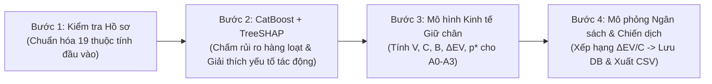

# CẨM NANG GIẢI THÍCH TOÀN BỘ DỰ ÁN (TỪ A ĐẾN Z — BẢN CHI TIẾT & DỄ HIỂU)

**Tên đề tài đề xuất (hợp lý và chuẩn trọng tâm mô hình):**  
> **“Xây dựng mô hình dự đoán khách hàng có khả năng rời bỏ và hỗ trợ đề xuất phương án giữ chân (kèm Web mô phỏng)”**

**Môn học:** Khoa học Dịch vụ (Service Science)

---

## PHẦN 1: BỨC TRANH TỔNG THỂ — DỰ ÁN NÀY LÀ GÌ & TẠI SAO ĐẶT TRỌNG TÂM Ở "MÔ HÌNH + WEB MÔ PHỎNG"?

### 1.1. Định vị đúng bản chất của dự án
Thay vì gọi sản phẩm là một "Website thương mại hoàn chỉnh" (dễ bị thầy cô soi các tính năng phụ như phân quyền nhiều người dùng, tích hợp tổng đài SMS/gọi điện thật), dự án được định vị chuẩn xác gồm **2 phần**:
1. **Trọng tâm cốt lõi (Core Models):** **Hệ thống Mô hình Dự báo & Giải thích Nguy cơ Rời bỏ (`CatBoost` + `TreeSHAP`)** kết hợp với **Mô hình Kinh tế Học Giữ Chân & Phân bổ Ngân sách ($\Delta EV$, $p^*$, Greedy Heuristic / Knapsack)**.
2. **Công cụ trình diễn (Web Mô phỏng / Demo):** Một **ứng dụng Web mô phỏng 4 Tab** dành cho người vận hành nội bộ, giúp trực quan hóa toàn bộ đường đi của dữ liệu từ lúc đưa hàng nghìn hồ sơ khách hàng vào mô hình cho đến lúc xuất ra danh sách kế hoạch chăm sóc.

> 💡 **Câu thông điệp cốt lõi của toàn dự án:**  
> *“Từ dữ liệu khách hàng, mô hình dự báo chính xác nguy cơ rời bỏ, giải thích minh bạch nguyên nhân theo từng cá nhân bằng TreeSHAP và mô phỏng bài toán kinh tế để đề xuất phương án giữ chân tối ưu theo nguồn lực của doanh nghiệp.”*

---

### 1.2. Bài toán thực tế mà mô hình giải quyết
Trong các doanh nghiệp dịch vụ thuê bao định kỳ (như nhà mạng Internet, Viễn thông):
1. **Vấn đề 1 — Nhận diện muộn và thiếu lý giải:** Mỗi tháng có nhiều thuê bao hủy dịch vụ (**Churn**). Nếu chỉ dự đoán bằng một con số xác suất khô khan, nhân viên chăm sóc khách hàng (CSKH) không biết khách hàng đang gặp vướng mắc ở khâu nào (kỹ thuật, hợp đồng hay giá cước) để tư vấn.
2. **Vấn đề 2 — Xung đột giữa Chi phí chăm sóc và Lợi nhuận thu về:**
   - Nếu tặng khuyến mãi tràn lan cho mọi khách hàng có rủi ro cao: Ngân sách sẽ nhanh chóng cạn kiệt.
   - Có những khách hàng rủi ro rời mạng rất cao nhưng chỉ dùng gói cước rẻ — chi phí tặng ưu đãi còn lớn hơn cả lợi nhuận mà khách đó mang lại.
   - Do đó, doanh nghiệp cần một **mô hình kết hợp cả Dự báo rủi ro (`CatBoost`) lẫn Tính toán kinh tế ($\Delta EV$)** để chỉ đầu tư nguồn lực vào những nơi mang lại lợi ích ròng dương ($\Delta EV > 0$).

---

## PHẦN 2: DỮ LIỆU ĐẦU VÀO — DÙNG FILE NÀO & Ý NGHĨA TỪNG CỘT LÀ GÌ?

### 2.1. Các tệp dữ liệu (Files) sử dụng trong hệ thống mô phỏng
Dự án sử dụng bộ dữ liệu viễn thông chuẩn **IBM Telco Customer Churn**, được tổ chức thành các tệp cụ thể trong thư mục `data/` và `artifacts/` của dự án:
1. **Tệp dữ liệu gốc (`data/raw/telco_churn.csv` — tên gốc `WA_Fn-UseC_-Telco-Customer-Churn.csv`):**
   - Quy mô: **7.043 khách hàng**, **21 cột dữ liệu**.
   - Lưu ý xử lý làm sạch: Cột `TotalCharges` trong file gốc có 11 dòng bị trống (ở các khách hàng mới hòa mạng có `tenure = 0`), khi nạp vào hệ thống được tự động chuẩn hóa kiểu số và thay bằng `0.0` để chấm điểm an toàn cho toàn bộ 7.043 hồ sơ.
2. **Gói mô hình đã huấn luyện (`artifacts/bundles/catboost-20261018T130222-seed42`):**
   - Huấn luyện từ tập dữ liệu chuẩn hóa (`4.930` mẫu train, `1.056` mẫu validation) và đóng gói thành bundle sẵn sàng chấm điểm hàng loạt (`ROC-AUC 84.8%` trên validation).
3. **Tệp dữ liệu tải lên linh hoạt (CSV Batch Upload trên Web):**
   - Người vận hành có thể tải lên bất kỳ tệp CSV chuẩn Telco mới nào từ thanh bên trái (ví dụ tệp mẫu `demo_telco_test_1000.csv` gồm **1.000 khách hàng** hoặc tệp snapshot cuối tuần/cuối tháng ngoài thực tế) để hệ thống kiểm tra cấu trúc và chấm điểm ngay lập tức.

---

### 2.2. Giải thích chi tiết toàn bộ 21 cột dữ liệu trong file CSV
Khi thuyết trình hoặc viết báo cáo, bạn có thể tra cứu bảng dưới đây để giải thích rành mạch ý nghĩa của từng cột:

#### Nhóm A: Định danh & Nhân khẩu học (5 cột)
| STT | Tên cột trong file | Kiểu / Giá trị | Giải thích ý nghĩa thực tế |
| :---: | :--- | :--- | :--- |
| 1 | `customerID` | Chuỗi (VD: `4132-KALRO`) | Mã định danh duy nhất của từng thuê bao khách hàng. |
| 2 | `gender` | `Male` / `Female` | Giới tính của chủ thuê bao. |
| 3 | `SeniorCitizen` | `0` (Không) / `1` (Có) | Cho biết khách hàng có phải là người cao tuổi ($\ge 65$ tuổi) hay không. |
| 4 | `Partner` | `Yes` / `No` | Khách hàng đã kết hôn / có người đồng hành hay chưa. |
| 5 | `Dependents` | `Yes` / `No` | Khách hàng có người phụ thuộc (con cái, cha mẹ già ở cùng) hay không. |

#### Nhóm B: Dịch vụ Viễn thông & Tiện ích Đang Sử dụng (10 cột)
| STT | Tên cột trong file | Kiểu / Giá trị | Giải thích ý nghĩa thực tế |
| :---: | :--- | :--- | :--- |
| 6 | `tenure` | Số nguyên (tháng) | **Thời gian gắn bó:** Số tháng khách hàng đã sử dụng dịch vụ của nhà mạng (từ 0 đến 72 tháng). |
| 7 | `PhoneService` | `Yes` / `No` | Khách hàng có đăng ký dịch vụ điện thoại cố định hay không. |
| 8 | `MultipleLines` | `Yes` / `No` / `No phone service` | Khách hàng có sử dụng nhiều đường dây điện thoại cùng lúc hay không. |
| 9 | `InternetService` | `DSL` / `Fiber optic` / `No` | Loại đường truyền Internet đang dùng: Cáp đồng (`DSL`), Cáp quang tốc độ cao (`Fiber optic`), hoặc không dùng Internet (`No`). |
| 10 | `OnlineSecurity` | `Yes` / `No` / `No internet service` | Dịch vụ bảo mật trực tuyến (chống mã độc, bảo vệ truy cập mạng). |
| 11 | `OnlineBackup` | `Yes` / `No` / `No internet service` | Dịch vụ sao lưu dữ liệu đám mây do nhà mạng cung cấp. |
| 12 | `DeviceProtection` | `Yes` / `No` / `No internet service` | Dịch vụ bảo vệ và hỗ trợ kỹ thuật cho thiết bị đầu cuối (Modem/Router). |
| 13 | `TechSupport` | `Yes` / `No` / `No internet service` | Gói hỗ trợ kỹ thuật chuyên sâu ưu tiên khi gặp sự cố mạng. |
| 14 | `StreamingTV` | `Yes` / `No` / `No internet service` | Dịch vụ truyền hình trực tuyến qua đường truyền Internet. |
| 15 | `StreamingMovies` | `Yes` / `No` / `No internet service` | Dịch vụ xem phim theo yêu cầu qua đường truyền Internet. |

#### Nhóm C: Hợp đồng, Thanh toán & Nhãn Rời bỏ (6 cột)
| STT | Tên cột trong file | Kiểu / Giá trị | Giải thích ý nghĩa thực tế |
| :---: | :--- | :--- | :--- |
| 16 | `Contract` | `Month-to-month` / `One year` / `Two year` | **Loại hợp đồng:** Theo từng tháng (dễ hủy nhất), Hợp đồng cam kết 1 năm, hoặc 2 năm. |
| 17 | `PaperlessBilling` | `Yes` / `No` | Khách hàng nhận hóa đơn điện tử (`Yes`) hay hóa đơn giấy truyền thống (`No`). |
| 18 | `PaymentMethod` | `Electronic check`, `Mailed check`, `Bank transfer (automatic)`, `Credit card (automatic)` | **Phương thức thanh toán:** Séc điện tử, Séc gửi bưu điện (2 hình thức trả thủ công từng kỳ) hoặc Chuyển khoản/Thẻ tín dụng tự động. |
| 19 | `MonthlyCharges` | Số thực (USD) | **Mức cước hàng tháng** khách hàng đang phải trả (dao động từ khoảng $\$18.25$ đến $\$118.75$). |
| 20 | `TotalCharges` | Số thực (USD) | **Tổng số tiền tích lũy** khách hàng đã thanh toán từ lúc bắt đầu hòa mạng. |
| 21 | `Churn` *(Nhãn)* | `Yes` / `No` | Trạng thái lịch sử: Khách hàng đã rời mạng (`Yes`) hay vẫn đang duy trì (`No`). Dùng để huấn luyện/đánh giá mô hình CatBoost và vẽ phân tích hành vi (EDA) ở Tab 2. |

---

## PHẦN 3: GIẢI THÍCH LUỒNG HOẠT ĐỘNG CỦA MÔ HÌNH & WEB MÔ PHỎNG (4 BƯỚC)

Toàn bộ hệ thống hoạt động theo một đường ống (pipeline) gồm **4 bước nối tiếp nhau**:

---

### BƯỚC 1: Tiếp nhận & Kiểm tra tính hợp lệ của dữ liệu (Data Validation)
Trước khi đưa vào mô hình dự đoán, hệ thống thực hiện kiểm tra tự động:
- Kiểm tra xem tệp CSV nạp vào có đủ 19 thuộc tính đầu vào bắt buộc hay không.
- Kiểm tra kiểu dữ liệu số (`tenure >= 0`, `MonthlyCharges > 0`, `TotalCharges >= 0`) và các giá trị phân loại có nằm trong danh mục cho phép hay không.
- **Tác dụng thực tế:** Ngăn chặn lỗi nhập liệu hoặc tệp CSV bẩn làm sai lệch kết quả phân tích của mô hình phía sau.

---

### BƯỚC 2: Mô hình Dự báo & Giải thích Nguy cơ Rời bỏ bằng CatBoost + TreeSHAP

#### 2.1. Cách mô hình hoạt động (Hiểu đơn giản, không dùng từ hàn lâm khó hiểu)
Hệ thống kết hợp **2 thành phần** chạy trực tiếp offline trong vài giây cho hàng nghìn khách hàng:
1. **Thành phần Dự báo (`CatBoost Bundle`):**
   - Trong 21 cột dữ liệu Telco có tới 15 cột phân loại (`Contract`, `InternetService`, `TechSupport`, `PaymentMethod`...). **CatBoost** là mô hình cây quyết định tăng cường (Gradient Boosting) xử lý rất mạnh các dữ liệu dạng bảng và biến phân loại.
   - Khi đưa tệp dữ liệu (ví dụ `7.043` hoặc `1.000` khách hàng) vào, CatBoost chấm ngay xác suất rời mạng ($p$ từ $0$ đến $1$) cho **toàn bộ danh sách** trong tích tắc, đạt hiệu năng kiểm chứng **ROC-AUC = 84.8%** (tập validation `1.056` khách hàng).
2. **Thành phần Giải thích 2 tầng (`Feature Importances` & `TreeSHAP`):**
   - **Tầng Toàn cục (Tab 2 — `02. Hành Vi Churn & Giải Thích Mô Hình`):** Kết hợp 4 biểu đồ hành vi rời mạng thực tế (EDA) với bảng xếp hạng **Top 10 đặc trưng ảnh hưởng nhất** của CatBoost (`Contract`, `tenure`, `MonthlyCharges`, `TechSupport`...), giúp quản lý biết tổng thể vì sao khách rời mạng để thiết kế chính sách gói `A1, A2, A3`.
   - **Tầng Cá nhân (Tab 3 — `Yếu Tố Tác Động Rủi Ro Đến Cá Nhân`):** Khi chọn một khách hàng cụ thể (ví dụ `4132-KALRO`), hệ thống tính **TreeSHAP** riêng cho hồ sơ đó:
     - **Thanh màu đỏ (+):** Những yếu tố đang kéo rủi ro rời mạng tăng lên (ví dụ: mới dùng 4 tháng, cước cao `$100.85`, hợp đồng từng tháng).
     - **Thanh màu xanh (−):** Những yếu tố đang giúp giảm nguy cơ rời mạng (ví dụ: đã kích hoạt `TechSupport = Yes`).
   - Toàn bộ kết quả được tóm tắt thành **Thẻ Gợi Ý Hành Động Cho Nhân Viên CSKH** gồm 3 phần ngắn gọn: *Nguyên nhân rủi ro chính*, *Đề xuất gói & Kênh liên hệ ưu tiên*, và *Gợi ý chăm sóc mở rộng*.

#### 2.2. Giải thích rõ khái niệm "Dữ kiện – Nhận định – Khuyến nghị" (Tại sao tương quan không phải là nhân quả?)
Hiểu bằng ngôn ngữ đời thường cực kỳ đơn giản như sau:
- **1. Dữ kiện (Fact):** Là thông tin **có thật 100% trên hồ sơ** (Ví dụ: *Khách hàng đang dùng hợp đồng theo tháng `Month-to-month` và chưa đăng ký gói hỗ trợ kỹ thuật `TechSupport = No`*).
- **2. Nhận định (Assessment):** Là **dấu hiệu cảnh báo rủi ro** do CatBoost & TreeSHAP tính ra từ dữ liệu thống kê (Ví dụ: *Giá trị TreeSHAP cho thấy hợp đồng tháng và cước cao đang đẩy xác suất rời mạng lên `84.6%`*).
  - 👉 *Giải thích ý "Tương quan không phải là nhân quả":* Trong dữ liệu thấy nhiều người thiếu `TechSupport` hay hủy mạng, nhưng ngoài đời thật chưa chắc họ hủy vì lý do đó (biết đâu họ hủy vì chuyển nhà hoặc vì đối thủ cạnh tranh khuyến mãi). Vì vậy, giải thích TreeSHAP là **dấu hiệu cảnh báo có căn cứ định lượng để nhân viên lưu tâm kiểm tra**, chứ không khẳng định cứng nhắc 100% đó là nguyên nhân duy nhất ngoài đời!
- **3. Khuyến nghị (Recommendation):** Là phương án chăm sóc gợi ý (`A0–A3`) để **con người (nhân viên vận hành) xem xét và phê duyệt**.

---

### BƯỚC 3: Mô hình Kinh tế Học Giữ Chân & Cụ thể hóa Phương án `A0–A3`

Sau khi mô hình CatBoost cho biết khách hàng có xác suất rời mạng $p$, **Mô hình Kinh tế Học Giữ Chân** sẽ giải bài toán: *"Có đáng bỏ tiền ra giữ khách hàng này không, và nên dùng gói chăm sóc nào?"*

#### 3.1. Ý nghĩa của 4 Phương án Chăm sóc (`A0–A3`)
Hệ thống định nghĩa 4 phương án đại diện cho các mức độ can thiệp khác nhau trong dịch vụ viễn thông:

| Mã | Tên phương án chăm sóc | Dữ kiện hồ sơ thường xem xét | Nội dung đề xuất cho người vận hành | Ý nghĩa dưới góc độ Dịch vụ |
| :---: | :--- | :--- | :--- | :--- |
| **`A0`** | **Không can thiệp (Theo dõi tiêu chuẩn)** | Rủi ro thấp ($p \le p^*$), hoặc mức cước quá nhỏ khiến chi phí tặng quà lớn hơn lợi nhuận giữ lại | Tiếp tục theo dõi định kỳ; phục vụ khách qua các kênh hỗ trợ tiêu chuẩn sẵn có | Tiết kiệm ngân sách cho doanh nghiệp; tránh lãng phí nguồn lực vào nơi gây lỗ ($\Delta EV \le 0$) |
| **`A1`** | **Hỗ trợ kỹ thuật & bảo mật chủ động** | Khách dùng Internet nhưng `TechSupport = No` hoặc `OnlineSecurity = No` | Liên hệ kiểm tra trải nghiệm mạng, hướng dẫn bảo mật hoặc kích hoạt hỗ trợ kỹ thuật | Cải thiện chất lượng sử dụng dịch vụ cốt lõi, tháo gỡ khó khăn kỹ thuật cho khách |
| **`A2`** | **Tư vấn hợp đồng & thanh toán tự động** | Hợp đồng ngắn hạn (`Month-to-month`), thanh toán thủ công (`Electronic check`, `Mailed check`) | Giải thích quyền lợi khi chuyển sang hợp đồng kỳ hạn dài hơn và hướng dẫn thanh toán tự động | Giảm sự bất tiện hàng tháng và tăng tính gắn kết lâu dài của thuê bao |
| **`A3`** | **Ưu đãi giảm cước cam kết dài hạn** | Hợp đồng `Month-to-month`, cước hàng tháng cao (`MonthlyCharges`), rủi ro rời bỏ lớn | Đề xuất gói ưu đãi/voucher giữ chân có giá trị cao để chốt cam kết dài hạn | Giữ chân nhóm khách hàng mang lại doanh thu lớn, cân đối giữa chi phí ưu đãi và giá trị thu về |

---

#### 3.2. Giải thích 6 Công thức của Mô hình Kinh tế (Kèm ví dụ con số cụ thể)
Để tính toán minh bạch, mô hình sử dụng các tham số cấu hình (người vận hành có thể kéo thanh trượt thay đổi trực tiếp trên thanh bên trái của Web):
- $H$: Kỳ hạn đánh giá giữ chân (mặc định trên Web: $H = 12\text{ tháng}$, có thể chọn 6, 12, 24).
- $m$: Biên lợi nhuận giả định (mặc định trên Web: $m = 0.50$, tức $50\%$ tiền cước là lợi nhuận gộp).
- Mỗi phương án có: Chi phí liên hệ $c_{\text{contact}}$, Chi phí ưu đãi $f_{\text{offer}}$, Tỷ lệ khách đồng ý nhận $u$ (*uptake rate*), và Hiệu lực giảm rủi ro khi khách đã nhận $e$ (*effectiveness*).

**Ví dụ minh họa trực quan (đúng theo thông số mặc định của gói `A3`):**  
Xét khách hàng có cước hàng tháng $\text{MonthlyCharges} = \$100.85$, xác suất rời mạng CatBoost dự báo $p = 0.846\ (84.6\%)$, với $H = 12\text{ tháng}$, $m = 0.50$, xét gói **`A3`** ($c_{\text{contact}} = \$3.0$, $f_{\text{offer}} = \$40.0$, $u = 0.40$, $e = 0.50$):

1. **Giá trị bảo vệ xấp xỉ của khách hàng trong $H$ tháng ($V$):**
   $$V = \text{MonthlyCharges} \times H \times m = \$100.85 \times 12 \times 0.50 = \$605.10$$
   *(Ý nghĩa: Nếu giữ được khách này trong 12 tháng tới, công ty thu về xấp xỉ $\$605.10$ lợi nhuận gộp. Đây là giá trị đóng góp trong $H$ tháng, gọi là Proxy CLV).*

2. **Chi phí kỳ vọng khi triển khai phương án ($C$):**
   $$C = c_{\text{contact}} + u \times f_{\text{offer}} = \$3.0 + 0.40 \times \$40.0 = \$19.00$$
   *(Ý nghĩa: Tốn $\$3.0$ chi phí nhân viên liên hệ ban đầu; còn gói voucher $\$40.0$ chỉ tốn khi khách đồng ý nhận với xác suất $40\%$, nên chi phí kỳ vọng trung bình là $\$19.00$).*

3. **Mức giảm rủi ro tương đối kỳ vọng ($r$):**
   $$r = u \times e = 0.40 \times 0.50 = 0.20\ (20\%)$$
   *(Ý nghĩa: Tác động kỳ vọng giúp kéo giảm $20\%$ nguy cơ rời mạng hiện tại của khách — ví dụ từ $84.6\%$ giảm xuống còn $67.7\%$).*

4. **Lợi ích kỳ vọng bảo vệ được ($B$):**
   $$B = p \times r \times V = 0.846 \times 0.20 \times \$605.10 \approx \$102.40$$
   *(Ý nghĩa: Số tiền lợi nhuận kỳ vọng cứu lại được nhờ thực hiện phương án chăm sóc).*

5. **Lợi nhuận ròng kỳ vọng ($\Delta EV$ — Expected Net Benefit):**
   $$\Delta EV = B - C = \$102.40 - \$19.00 = +\$83.40$$
   *(Ý nghĩa: Sau khi lấy giá trị cứu được trừ đi chi phí bỏ ra, doanh nghiệp vẫn lời kỳ vọng $+\$83.40$. Ở Tab 3, phương án nào có $\Delta EV$ dương lớn nhất sẽ được gắn nhãn **`TỐI ƯU`**).*

6. **Ngưỡng rủi ro hòa vốn lý thuyết ($p^*$ — Break-even Risk Threshold):**
   $$p^* = \frac{C}{r \times V} = \frac{\$19.00}{0.20 \times \$605.10} = \frac{\$19.00}{\$121.02} \approx 0.157\ (15.7\%)$$
   *(Ý nghĩa: Với khách hàng đóng cước $\$100.85/\text{tháng}$, xác suất rời mạng $p$ phải vượt quá $15.7\%$ thì gói chăm sóc $\$19.00$ mới bắt đầu hòa vốn. Vì $p = 84.6\% > 15.7\%$ nên can thiệp là rất có lợi!).*

---

### BƯỚC 4: Mô phỏng Phân bổ Ngân sách, Quản lý Chiến dịch & Hàng đợi

1. **Giải bài toán Ngân sách hữu hạn bằng Heuristic tham lam (Knapsack / Greedy Heuristic):**
   - Khi có nhiều khách hàng cùng có $\Delta EV > 0$, nhưng tổng ngân sách cho phép chỉ có trần $B_{\text{ngân sách}}$ (ví dụ $\$15,000$):
   - Mô hình tính chỉ số **Hiệu suất đầu tư** cho từng phương án: $\text{Tỷ suất} = \frac{\Delta EV}{C}$.
   - Hệ thống sắp xếp khách hàng/gói theo tỷ suất $\frac{\Delta EV}{C}$ từ cao xuống thấp và duyệt chọn lần lượt cho đến khi tổng chi phí kỳ vọng chạm trần ngân sách.
   - *Lưu ý hay khi thuyết trình:* Ở Tab 3 (chưa giới hạn ngân sách), hệ thống chọn gói có $\Delta EV$ tuyệt đối cao nhất (như `A3`). Nhưng sang Tab 4 khi bị giới hạn ngân sách, hệ thống ưu tiên tỷ suất $\Delta EV / C$ cao nhất nên có thể chọn gói tiết kiệm hơn như `A2` để phục vụ được nhiều khách hàng hơn và tối đa hóa tổng lợi nhuận toàn chiến dịch.

2. **Lưu Chiến dịch & Xuất file CSV bàn giao:**
   - Danh sách khách hàng được chọn (kèm phương án, chi phí, lợi ích kỳ vọng) được lưu vĩnh viễn vào cơ sở dữ liệu chiến dịch (**Campaign Persistence**) và xuất ra tệp `.CSV` để bàn giao cho bộ phận CSKH xem xét thực hiện.

3. **Hàng đợi xử lý lô (`Task Queue`) & Cơ chế chống trùng lặp (`Idempotency`):**
   - Trên thanh bên trái của Web, khi bấm **"Chạy & Ghi Nhận Scoring Job"**, yêu cầu chấm điểm theo lô được đẩy vào hàng đợi quản lý trạng thái (`PENDING` $\rightarrow$ `RUNNING` $\rightarrow$ `SUCCESS` / `FAILED`) trong SQLite (`data/task_queue.db`) kèm **khóa chống trùng (`idempotency_key`)** để tránh chạy lặp và ghi đè trùng lặp trên cùng tệp dữ liệu và model.

---

### BƯỚC 5: Quy trình Tích hợp Hệ thống & Điều phối Vận hành (System Pipeline)

Hệ thống được cấu trúc thành **5 mắt xích vận hành logic** khép kín:

| Mắt xích vận hành | Nội dung xử lý kỹ thuật | Ý nghĩa quản trị dịch vụ |
| :--- | :--- | :--- |
| **1. Tiếp nhận & Kiểm tra dữ liệu** | Kiểm tra 19 trường bắt buộc, ép kiểu số `TotalCharges`, kiểm tra miền giá trị hợp lệ. | Đảm bảo tính toàn vẹn dữ liệu trước khi đưa vào mô hình; ngăn chặn sai số từ khâu nhập liệu. |
| **2. Dự báo & Giải thích (CatBoost + TreeSHAP)** | Chấm điểm xác suất rời mạng hàng loạt bằng **CatBoost** (`ROC-AUC 84.8%`) và giải thích cá nhân bằng **TreeSHAP**. | Cung cấp điểm rủi ro chính xác tức thì cho hàng nghìn khách hàng kèm lý giải minh bạch cho CSKH. |
| **3. Định lượng kinh tế dịch vụ (`A0–A3`)** | Tính toán tự động giá trị bảo vệ ($V$), chi phí kỳ vọng ($C$), lợi ích ($B$), lợi nhuận ròng ($\Delta EV$) và ngưỡng hòa vốn ($p^*$). | Đưa ra căn cứ kinh tế định lượng, loại bỏ các can thiệp gây lỗ hoặc không hiệu quả. |
| **4. Phân bổ nguồn lực ngân sách** | Ứng dụng thuật toán **Knapsack (Greedy Heuristic)** xếp hạng theo tỷ suất $\Delta EV / C$ dưới trần ngân sách $B$ và phân tích độ nhạy biên lợi nhuận. | Tối ưu hóa hiệu quả sử dụng ngân sách hữu hạn của doanh nghiệp; minh bạch danh sách ưu tiên. |
| **5. Điều phối tác vụ & Bàn giao** | Quản lý tác vụ qua **Task Queue (`idempotency_key`)**, lưu vết chiến dịch và xuất tệp `.CSV` kế hoạch. | Đảm bảo hệ thống vận hành an toàn, không trùng lặp tác vụ và sẵn sàng bàn giao danh sách cho bộ phận thực thi. |

---

## PHẦN 4: GÓC NHÌN KHOA HỌC DỊCH VỤ (SERVICE SCIENCE)

### 4.1. Sơ đồ Quy trình Phục vụ 4 Lớp (Service Blueprint) — Giải thích cực dễ hiểu
Trong môn *Khoa học Dịch vụ*, một hệ thống dịch vụ hoàn chỉnh được chia thành **4 lớp từ ngoài vào trong** (ngăn cách nhau bởi ranh giới tiếp xúc và ranh giới những gì khách hàng nhìn thấy được):

1. **Lớp 1 — Hành động của Khách hàng (Customer Actions):**
   - Là những gì người dùng mạng Internet/Điện thoại thực hiện ngoài đời: sử dụng mạng hàng ngày, đóng cước, gặp sự cố kỹ thuật hoặc cân nhắc việc gia hạn/hủy hợp đồng.
   - *Lưu ý:* Khách hàng cuối **không** sử dụng trang Web mô phỏng này; trạng thái của họ được phản ánh qua các cột dữ liệu hồ sơ.
2. **Lớp 2 — Tuyến đầu tiếp xúc trực tiếp với khách (Frontstage):**
   - Là nhân viên tư vấn/tổng đài viên CSKH — những người trực tiếp gọi điện (Tổng đài Outbound 1-1) hoặc nhắn tin (Zalo OA / App), hướng dẫn kỹ thuật, giải thích hợp đồng hoặc gửi ưu đãi cho khách hàng dựa trên **Thẻ Gợi Ý Hành Động CSKH** ở Tab 3 và tệp CSV xuất từ Tab 4.
3. **Lớp 3 — Xử lý nội bộ hậu trường (Backstage — Nơi khách hàng không nhìn thấy):**
   - Là chuyên viên vận hành sử dụng **Web mô phỏng 4 Tab của nhóm** để nạp dữ liệu mới, xem phân tích hành vi (Tab 2), tra cứu hồ sơ 360° & TreeSHAP (Tab 3), chạy tối ưu ngân sách và xuất danh sách chiến dịch (Tab 4).
4. **Lớp 4 — Hệ thống Mô hình & Hạ tầng hỗ trợ chạy ngầm (Support Processes):**
   - Là toàn bộ phần lõi kỹ thuật chạy bên dưới: Bộ kiểm tra dữ liệu, Mô hình **CatBoost Bundle**, Bộ tính **TreeSHAP**, Mô-đun tính toán kinh tế & **Knapsack**, Cơ sở dữ liệu chiến dịch và **Task Queue (`task_queue.db`)**.

---

### 4.2. Đề xuất Chi tiết 5 Hướng Dịch Vụ Chăm Sóc Mở Rộng (Khai thác sâu các cột dữ liệu trong `telco_churn.csv`)

Hiện tại, 4 phương án cấu hình sẵn (`A0–A3`) mới chủ yếu khai thác 5 cột (`TechSupport`, `OnlineSecurity`, `Contract`, `PaymentMethod`, `MonthlyCharges`). Trong khi đó, bảng dữ liệu `telco_churn.csv` vẫn còn **9 cột thuộc tính rất giá trị** (`tenure`, `SeniorCitizen`, `Partner`, `Dependents`, `MultipleLines`, `OnlineBackup`, `DeviceProtection`, `StreamingTV`, `StreamingMovies`).

Từ góc nhìn **Khoa học Dịch vụ (Thiết kế Dịch vụ mới — Service Design)**, hệ thống tích hợp **5 hướng dịch vụ chăm sóc mở rộng** ngay trong thẻ **Gợi Ý Hành Động Cho Nhân Viên CSKH** ở Tab 3 (và cột gợi ý khi xuất CSV ở Tab 3):

> 📌 *Lưu ý học thuật khi trình bày:* Đây là 5 kịch bản **đề xuất phát triển nghiệp vụ dịch vụ** dựa trên gợi ý từ các trường dữ liệu hồ sơ. Trước khi triển khai thương mại thực tế, doanh nghiệp cần khảo sát xác nhận nhu cầu của khách hàng và kiểm tra các điều kiện vận hành tương ứng.

---

#### 🌟 Dịch vụ Mở rộng 1: “Đồng Hành Giai Đoạn Đầu Cho Thuê Bao Mới” (Dựa trên cột `tenure`)
* **Trường dữ liệu gợi ý:** Cột `tenure` (số tháng khách hàng đã gắn bó, đặc biệt là nhóm khách hàng mới hòa mạng).
* **Vấn đề thực tế (Pain Point):** Khách hàng mới hòa mạng là nhóm dễ hủy dịch vụ nhất vì chưa quen thao tác quản lý modem, đặt Wi-Fi ở vị trí sóng yếu, hoặc thấy hóa đơn tháng đầu khác với kỳ vọng.
* **Nội dung đề xuất:** Kiểm tra chất lượng đường truyền từ xa trong giai đoạn đầu, hướng dẫn sử dụng App quản lý Wi-Fi và giải đáp hóa đơn kỳ đầu.
* **Giá trị Khoa học Dịch vụ:** Giúp khách hàng vượt qua giai đoạn "bỡ ngỡ đầu kỳ", hình thành thói quen sử dụng ổn định trước khi nảy sinh ý định rời mạng.

#### 🌟 Dịch vụ Mở rộng 2: “Kênh Hỗ Trợ & Tư Vấn Thân Thiện Cho Người Cao Tuổi” (Dựa trên cột `SeniorCitizen`)
* **Trường dữ liệu gợi ý:** Cột `SeniorCitizen = 1` (Khách hàng từ 65 tuổi trở lên).
* **Vấn đề thực tế (Pain Point):** Người cao tuổi ngại bấm phím tự động nhiều tầng khi gọi tổng đài hoặc dễ quên lịch thanh toán cước hàng tháng.
* **Nội dung đề xuất:** Ưu tiên định tuyến gặp trực tiếp nhân viên tổng đài thân thiện, kèm hướng dẫn bản chữ rõ ràng và nhắc cước phù hợp (có sự đồng ý của khách hàng).
* **Giá trị Khoa học Dịch vụ:** Thể hiện sự thấu cảm trong thiết kế dịch vụ (**Inclusive Service Design**), xóa bỏ rào cản công nghệ cho nhóm khách hàng lớn tuổi.

#### 🌟 Dịch vụ Mở rộng 3: “Tư Vấn Gói Cước Gia Đình & Đa Thiết Bị” (Dựa trên `Partner`, `Dependents`, `MultipleLines`)
* **Trường dữ liệu gợi ý:** Các cột `Partner = Yes`, `Dependents = Yes` và `MultipleLines = Yes`.
* **Vấn đề thực tế (Pain Point):** Hộ gia đình dùng nhiều đường dây rời rạc sẽ tốn tổng cước cao hơn so với dùng gói gộp.
* **Nội dung đề xuất:** Gợi ý gộp hóa đơn Internet cố định và nhiều đường dây cho hộ gia đình để tối ưu tổng chi phí (cần hỏi thăm xác nhận nhu cầu thật).
* **Giá trị Khoa học Dịch vụ:** Gia tăng **giá trị gắn kết hệ sinh thái (Switching Cost tích cực)**: Khi nhiều thành viên cùng hưởng lợi trên một gói chung, khả năng rời bỏ sẽ giảm đáng kể.

#### 🌟 Dịch vụ Mở rộng 4: “Tư Vấn Sao Lưu Đám Mây & Bảo Vệ Thiết Bị Đầu Cuối” (Dựa trên `OnlineBackup`, `DeviceProtection`)
* **Trường dữ liệu gợi ý:** Cột `OnlineBackup = No` hoặc `DeviceProtection = No` trên các thuê bao đang dùng Internet.
* **Vấn đề thực tế (Pain Point):** Nếu chỉ bán đường truyền vật lý thuần túy, khi Modem/Router hỏng hoặc mất dữ liệu cá nhân, khách hàng dễ đổ lỗi cho nhà mạng kém và hủy hợp đồng.
* **Nội dung đề xuất:** Tư vấn bổ sung không gian sao lưu đám mây và dịch vụ bảo trì/hỗ trợ thiết bị đầu cuối định kỳ.
* **Giá trị Khoa học Dịch vụ:** Chuyển từ *"bán đường truyền vật lý đơn thuần"* sang *"cung cấp giải pháp an tâm toàn diện"*.

#### 🌟 Dịch vụ Mở rộng 5: “Tư Vấn Gói Giải Trí Tích Hợp Trên Đường Truyền Tốc Độ Cao” (Dựa trên `StreamingTV`, `StreamingMovies`, `InternetService`)
* **Trường dữ liệu gợi ý:** Khách hàng đang dùng Cáp quang (`Fiber optic`) nhưng chưa đăng ký `StreamingTV` hoặc `StreamingMovies`.
* **Vấn đề thực tế (Pain Point):** Nhóm khách dùng Cáp quang trả cước cao dễ thấy *"chi phí chưa tương xứng với giá trị"* nếu chỉ lướt web thông thường.
* **Nội dung đề xuất:** Tích hợp thêm quyền lợi xem Truyền hình hoặc Phim trực tuyến phù hợp với sở thích gia đình thay vì giảm giá tiền mặt trực tiếp làm giảm ARPU.
* **Giá trị Khoa học Dịch vụ:** Áp dụng nguyên lý **Đồng sáng tạo giá trị (Value Co-creation)** — tăng trải nghiệm nội dung số trên băng thông sẵn có.

---

## PHẦN 5: CẨM NANG HỎI – ĐÁP PHẢN BIỆN & CẤU TRÚC NHÁNH CODE

### 5.1. Tổ chức nhánh Git hiện tại của nhóm
1. **Nhánh `backup-main`:** Lưu nguyên vẹn bản code cũ trên `main` (`LLM + RAG`) để đối chiếu khi cần.
2. **Nhánh `demo-test-04-khdv` & `demo-05`:** Bản hoàn chỉnh theo hướng **CatBoost (`ROC-AUC 84.8%`) + TreeSHAP + Kinh tế ($\Delta EV$, $p^*$, Knapsack) + Giao diện Eva Design System 4 Tab**, đang chạy demo trên cổng `8505`.
3. **Nhánh `demo-test-04`:** Bản gốc trước khi tinh chỉnh riêng cho môn KHDV, được giữ nguyên vẹn không chỉnh sửa.

### 5.2. Cách trả lời nhanh 4 câu hỏi phản biện thường gặp nhất của Giảng viên
- **Hỏi 1 — Tại sao chọn CatBoost + TreeSHAP thay vì dùng LLM dự báo trực tiếp?**  
  $\rightarrow$ *CatBoost chấm hàng loạt 7.043 khách hàng chỉ trong vài giây, có chỉ số đo chuẩn (`ROC-AUC 84.8%` trên validation), không tốn phí API và không phụ thuộc mạng. TreeSHAP giải thích nhất quán từng yếu tố tác động đến cá nhân, kết hợp với Thẻ Gợi Ý Hành Động CSKH giúp nhân viên tổng đài dễ đọc ngay. Hướng LLM có thể tích hợp ở tương lai để viết kịch bản thoại cá nhân hóa sau khi CatBoost + Knapsack đã lọc xong danh sách.*
- **Hỏi 2 — Bộ dữ liệu Kaggle này cũ rồi (2017–2018), ngoài đời dữ liệu thay đổi theo tuần/tháng thì sao?**  
  $\rightarrow$ *Dữ liệu thuê bao thật của nhà mạng là dữ liệu mật nên nhóm dùng bộ benchmark IBM Telco (ảnh chụp tĩnh tại một kỳ chốt cước) để kiểm chứng giải pháp. Hệ thống đã có sẵn nút tải lên tệp CSV mới theo từng tuần/tháng và Task Queue lưu vết, đồng thời tách rời Model Bundle để doanh nghiệp chỉ cần nạp dữ liệu mới nhất vào huấn luyện lại (retrain) là chạy được ngay.*
- **Hỏi 3 — Kết quả $\Delta EV$ có phải lợi nhuận thực tế chắc chắn 100% không?**  
  $\rightarrow$ *Đây là giá trị kỳ vọng mô phỏng (Expected Value) dựa trên giả định biên lợi nhuận $m$, kỳ hạn $H$, tỷ lệ chấp nhận $u$ và hiệu lực giảm churn $e$. Hệ thống cung cấp thanh trượt ở thanh bên trái và biểu đồ Độ nhạy biên lợi nhuận (`MARGIN SENSITIVITY`) ở Tab 4 để doanh nghiệp kiểm tra nhiều kịch bản trước khi triển khai.*
- **Hỏi 4 — Thuật toán chọn khách hàng khi thiếu ngân sách hoạt động ra sao?**  
  $\rightarrow$ *Hệ thống dùng thuật toán Heuristic tham lam (Knapsack / Greedy Heuristic): xếp hạng các khách hàng có $\Delta EV > 0$ theo tỷ suất lợi ích ròng trên chi phí ($\Delta EV / C$) từ cao xuống thấp và chọn lần lượt cho đến khi chạm trần ngân sách kỳ vọng — nhờ vậy tối đa hóa tổng lợi nhuận trên mỗi đồng ngân sách bỏ ra.*
