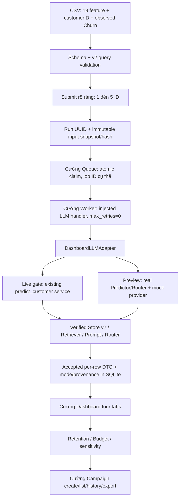

# Dashboard Cường làm app chính — LLM/RAG v2 là dịch vụ dự đoán

Nguồn UI/dịch vụ Cường: `origin/demo-test-04@911a60a028cb89507d35fbe584059f30f7ee2da4`.
Bản tích hợp chỉ nằm trong bản sao riêng, không merge/cherry-pick/commit/push/deploy.

## Dashboard trước đây dùng model gì?

`dashboard/app.py:761–769` của source tìm model.pkl đầu tiên trong artifacts/bundles hoặc
artifacts/bundle; `app.py:813–830` dùng BundlePredictor.load/predict_batch. Predictor ở
`adapters/predictor/bundle_predictor.py:18–33` gọi load_bundle và LoadedBundle.predict_proba.
`ml/training/bundle.py:115–147` chọn class 1 và gọi pipeline.predict_proba; loader tại
150–191 mở pickle/schema/metadata. Không kiểm tra loại Logistic Regression tại boundary.

Artifact được commit cùng source là `catboost-20261018T130222-seed42`:
metadata model_type=catboost; kiểm tra opcode pickle, không unpickle, thấy
sklearn.pipeline.Pipeline và catboost.core.CatBoostClassifier. Đây là bằng chứng CatBoost
cho artifact đó, không phải kết luận chỉ dựa vào nhãn UI. Resolver chọn file đầu tiên nên
môi trường có nhiều bundle có thể nạp bundle khác; không suy đoán model của process lạ.
Demo source dùng FakePredictor(seed=42), vẫn ưu tiên CSV thật nếu có và còn cached bundle
riêng cho SHAP. Không dùng các đường này trong Dashboard LLM mới.

## Luồng mới



Preview dùng MOCK provider, không có API request thật. `mock_prediction` đi qua Predictor,
Store/Retriever, Prompt, Router và response validation thật, chỉ generation là giả.
Live adapter có server-side opt-in và trỏ đúng Prediction Service `predict_customer` có
sẵn; test nối qua service đó với factory Router mock. UI preview không mở chế độ live.
Không đổi service/predictor API hoặc implementation Router/Providers.

## Hợp đồng dữ liệu

- CSV đúng 21 cột: 19 feature, customerID, Churn đã quan sát. customerID được đọc dạng
  chuỗi, giữ leading zero; không rỗng/trùng. CSV UTF-8, tối đa 2 MB/1.000 dòng để validate.
- Không fill mọi TotalCharges lỗi/thiếu thành 0. Dùng validation hiện có: chỉ cho missing
  TotalCharges khi tenure=0. Categorical vocab/schema và vector do v2 Store quyết định.
- Model chỉ nhận Mapping đúng 19 feature; ID và observed Churn không vào prompt/query.
  Không gán churn_prediction sang Churn. Prediction class do LLM trả giữ nguyên.
- Submit đơn một ID hoặc batch tối đa năm ID được chọn; không chấm toàn CSV trên load,
  upload, rerun, đổi tab, lọc khách hoặc đổi tham số kinh tế.
- Một row là một logical prediction; Router có thể gọi primary và fallback/hedge theo
  chính sách cũ. Max 5 logical predictions không có nghĩa max 5 provider requests.
- Timeout service cũ: Groq90s/Gemini30s, hedge60s/tổng120s mỗi logical call. Batch tuần tự
  tối đa khoảng 600s cộng overhead. Không thêm retry quanh Router; preview trả mock tức thì.

## Persistence và lỗi

SQLite state riêng, không dùng/sửa data/predictions.db hoặc model bundle cũ.
`dashboard_runs` lưu UUID, request key hash đầy đủ, snapshot/dataset hash, mode,
reference version/pin, predictor config ref; `dashboard_outcomes` lưu class/probability/
reason/provider/reference_count/calibrated=False và từng trạng thái attempt.

Request hash dùng request token + nội dung cohort + reference/pin + mode, không chỉ tên
file hay model prefix. Click lặp cùng request trả run cũ, không inference lại. Đổi nội dung
CSV dù cùng tên tạo run khác. Nút **Tạo lượt mới** cấp token mới nhưng chưa gọi LLM;
người dùng vẫn phải submit rõ ràng. Run ID collision khác request bị lỗi, không bỏ qua
để dùng probability cũ. Attempt được ghi trước provider call; kết quả thành công ghi
trước row kế tiếp và không ghi đè accepted outcome.

Sau lỗi đầu tiên: fail-fast, giữ các row thành công, không chấm các row còn lại. Run có
trạng thái PARTIAL/FAILED; Dashboard/Retention chỉ dùng successful subset và hiển thị
số row thành công/tổng số trong snapshot. Raw SDK exceptions/prompt/API keys không lưu
vào DB hoặc đưa ra UI. Unknown attempts sau crash không tự replay.

Queue giữ chức năng job/status/idempotency, sửa atomic claim và fenced completion.
Process chỉ đúng job vừa submit, không nhặt job khác trong queue. Job LLM max_retries=0.
Job RUNNING bị ngắt chỉ đóng khi người dùng xác nhận worker đã dừng; thao tác này đánh
unknown/failed, không gọi lại API. Đây không phải bảo đảm exactly-once billing của provider.
Không dùng cơ chế lease tự retry một API call có thể đã phát sinh phí.

Legacy default handler/IdempotentPredictionStore còn trong worker.py cho compatibility,
nhưng Dashboard inject handlers rõ ràng và không khởi tạo store đó. Runtime isolation
chặn model imports/files và constructor legacy store để kiểm chứng ranh giới này.

## Business UI giữ lại

Bốn tab Cường: tổng quan kinh tế; observed churn/LLM reason; Customer360; Budget/Campaigns.
Giữ action catalog/conditions, greedy budget, margin sensitivity, bộ lọc/profile/charts,
Campaign create/list/history/export. Sửa all-A0/empty report, literal customer search,
escape ID khi dựng HTML, giới hạn chi phí không âm và chặn overflow kinh tế.

Global/Local TreeSHAP bị vô hiệu hóa riêng. Không làm feature importance giả cho LLM.
Thay bằng reason được hiển thị như text, có nhãn mock/provider/reference. Bỏ nhãn
CatBoost ROC-AUC cũ vì không mô tả LLM. EDA dùng observed Churn trong accepted cohort,
không được coi là performance validation hoặc quan hệ nhân quả của LLM.

Campaign dùng scoring_run_id thật, dataset hash của accepted subset, predictor config
ref (không phải actual provider model version), reference pin/version, execution mode,
calibrated=False và đầy đủ action params. Snapshot bất biến tại repository; cập nhật
status không được đổi cohort/budget/results. CSV preview read-only; status EXPORTED chỉ
khi người dùng bấm download, biểu thị export request chứ không chứng minh tải xong.
CSV giữ 6 cột tương thích; tên file xuất preview có tiền tố MOCK và báo cáo ghi rõ mode.
CSV có bảo vệ formula injection cho text/ID. NaN breakeven không xác định được serialize
thành JSON null, không đổi phép tính engine.

## Preview và kiểm thử

Preview launcher ngoài repository đặt light theme phù hợp CSS Cường, tắt telemetry,
xóa API keys, chặn socket connect ra ngoài và chỉ bind localhost. Server cũ giữ nguyên.
Có sẵn run gồm bốn khách tổng hợp, provider outputs giả; đây không phải kết quả thật.
Không cần Terminal để trải nghiệm preview đã được khởi chạy.

Nếu khởi chạy thủ công trong một môi trường phát triển đã chuẩn bị artifact đúng pin:

```bash
PYTHONPATH=src python3 -m churn_retention.dashboard.demo
```

Launcher demo một quản trị viên tạo SQLite riêng trong thư mục tạm 0700;
`--state-dir` chỉ nhận thư mục demo riêng có marker, không nhận database production.
Lệnh `streamlit run` trực tiếp không được phục vụ Dashboard. Xem
[group5_single_admin_security.md](group5_single_admin_security.md) để biết điều kiện vận hành. API keys không cần cho mock. Plotly>=7.1,<8 là dependency trực
 tiếp của Dashboard, đã kiểm thử với 7.1.0; task không cài/download package.

Test mới dùng synthetic CSV/artifact và fake providers: upload đúng bytes, ID alignment,
missing/duplicate/schema errors, run collision/idempotency, batch cap/partial/fail-fast,
atomic claims/recovery fencing, business UI all-A0, persistence/Campaign immutability và
chặn inference trên rerun. Minimal deployment process sạch không có training/ML code,
CSV thật, bundle/v1; cấm provider SDK/network/refit/classifier construction/unpickle.
Full regression giữ các golden fixtures và source preprocessing/RAG/prompt/router nguyên byte.

## Giới hạn

Live API không mở trên preview và chưa được kiểm chứng bằng API thật. Actual model version
không có trong DTO hiện tại; config ref không được trình bày là model version thực tế.
Chưa có production auth/tenant isolation, API billing guarantee hoặc worker fleet vận hành.
Probability chưa hiệu chuẩn và efficacy/acceptance là giả định; ROI chỉ là mô phỏng.
Artifact v2 hợp lệ vẫn là điều kiện mở luồng Dashboard hiện tại; không có read-only history
mode khi artifact không khả dụng. Không fallback v1/classifier. Bộ dependencies chung vẫn
chứa packages ML của toàn project, dù runtime Dashboard LLM không dùng classifier.
