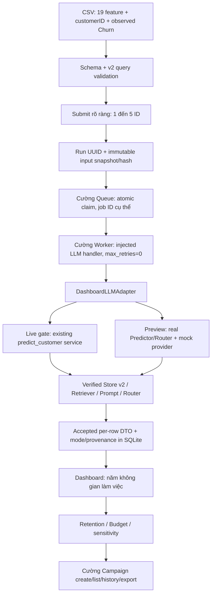

# Dashboard Cường — main dùng LLM/RAG v2

Giao diện trên nhánh review `codex/dashboard-redesign` đã tổ chức lại thành năm
khu vực. Xem [bản đồ chức năng và hướng dẫn mới](dashboard_redesign.md).
Các kết quả kiểm chứng ở cuối tài liệu này thuộc đợt tách classifier trước cải tạo.

UI/nghiệp vụ nguồn: demo-test-04@911a60a. Bản trước khi tách classifier được bảo toàn
ở [codex/archive-self-training-2026-11-02](https://github.com/dungngo2612/customer-churn-retention/tree/codex/archive-self-training-2026-11-02), commit `10d72b9`.
Các snapshot audit/inventory trước đây xem trên nhánh đó; không dùng hướng dẫn
train/SHAP/CLI cũ cho main hiện tại.

## Luồng LLM/RAG hiện hành



Preview dùng MOCK provider, không có API request thật. `mock_prediction` đi qua Predictor,
Store/Retriever, Prompt, Router và response validation thật, chỉ generation là giả.
Live adapter có server-side opt-in và trỏ đúng Prediction Service `predict_customer` có
sẵn; test nối qua service đó với factory Router mock. UI preview không mở chế độ live.
Không đổi service/predictor API hoặc implementation Router/Providers.

## Hợp đồng dữ liệu

- CSV đúng 21 cột: 19 feature, customerID, Churn đã quan sát. customerID được đọc dạng
  chuỗi, giữ leading zero; không rỗng/trùng. CSV UTF-8, tối đa 2 MB/1.000 dòng để validate.
- Không fill mọi TotalCharges lỗi/thiếu thành 0. Dùng validation hiện có: chỉ cho missing
  TotalCharges khi tenure=0. Categorical vocab/schema và vector do v2 Store quyết định.
- Model chỉ nhận Mapping đúng 19 feature; ID và observed Churn không vào prompt/query.
  Không gán churn_prediction sang Churn. Prediction class do LLM trả giữ nguyên.
- Submit đơn một ID hoặc batch tối đa năm ID được chọn; không chấm toàn CSV trên load,
  upload, rerun, đổi tab, lọc khách hoặc đổi tham số kinh tế.
- Một row là một logical prediction; Router có thể gọi primary và fallback/hedge theo
  chính sách cũ. Max 5 logical predictions không có nghĩa max 5 provider requests.
- Timeout service cũ: Groq90s/Gemini30s, hedge60s/tổng120s mỗi logical call. Batch tuần tự
  tối đa khoảng 600s cộng overhead. Không thêm retry quanh Router; preview trả mock tức thì.

## Persistence và lỗi

SQLite state riêng, không dùng/sửa data/predictions.db hoặc model bundle cũ.
`dashboard_runs` lưu UUID, request key hash đầy đủ, snapshot/dataset hash, mode,
reference version/pin, predictor config ref; `dashboard_outcomes` lưu class/probability/
reason/provider/reference_count/calibrated=False và từng trạng thái attempt.

Request hash dùng request token + nội dung cohort + reference/pin + mode, không chỉ tên
file hay model prefix. Click lặp cùng request trả run cũ, không inference lại. Đổi nội dung
CSV dù cùng tên tạo run khác. Nút **Tạo lượt mới** cấp token mới nhưng chưa gọi LLM;
người dùng vẫn phải submit rõ ràng. Run ID collision khác request bị lỗi, không bỏ qua
để dùng probability cũ. Attempt được ghi trước provider call; kết quả thành công ghi
trước row kế tiếp và không ghi đè accepted outcome.

Sau lỗi đầu tiên: fail-fast, giữ các row thành công, không chấm các row còn lại. Run có
trạng thái PARTIAL/FAILED; Dashboard/Retention chỉ dùng successful subset và hiển thị
số row thành công/tổng số trong snapshot. Raw SDK exceptions/prompt/API keys không lưu
vào DB hoặc đưa ra UI. Unknown attempts sau crash không tự replay.

Queue giữ chức năng job/status/idempotency, sửa atomic claim và fenced completion.
Process chỉ đúng job vừa submit, không nhặt job khác trong queue. Job LLM max_retries=0.
Job RUNNING bị ngắt chỉ đóng khi người dùng xác nhận worker đã dừng; thao tác này đánh
unknown/failed, không gọi lại API. Đây không phải bảo đảm exactly-once billing của provider.
Không dùng cơ chế lease tự retry một API call có thể đã phát sinh phí.

Worker chỉ chạy handlers được inject; default handler classifier và prediction store
cũ đã được loại. Claim/fencing/retry của Queue/Worker và ledger LLM giữ nguyên.
Import isolation chặn classifier bundles, SHAP, CatBoost và MLflow.

## Business UI giữ lại

Thanh điều hướng gồm Tổng quan; Khách hàng & dữ liệu; Phân tích rời bỏ;
Kế hoạch giữ chân; Chiến dịch. Giữ action catalog/conditions, greedy budget,
margin sensitivity, bộ lọc/profile/charts, Campaign create/list/history/export.
Kế hoạch có ba bước; Queue kỹ thuật nằm trong Chiến dịch. Bộ lọc chạy trước phân
trang 10/25/50; kết quả và thiết lập đã áp dụng được giữ khi chuyển trang.
All-A0/empty report, literal customer search, escape ID khi dựng HTML, giới hạn
chi phí không âm và chặn overflow kinh tế tiếp tục được bảo toàn.

Global/Local TreeSHAP bị vô hiệu hóa riêng. Không làm feature importance giả cho LLM.
Thay bằng reason được hiển thị như text, có nhãn mock/provider/reference. Bỏ nhãn
CatBoost ROC-AUC cũ vì không mô tả LLM. EDA dùng observed Churn trong accepted cohort,
không được coi là performance validation hoặc quan hệ nhân quả của LLM.

Campaign dùng scoring_run_id thật, dataset hash của accepted subset, predictor config
ref (không phải actual provider model version), reference pin/version, execution mode,
calibrated=False và đầy đủ action params. Snapshot bất biến tại repository; cập nhật
status không được đổi cohort/budget/results. CSV preview read-only; status EXPORTED chỉ
khi người dùng bấm download, biểu thị export request chứ không chứng minh tải xong.
CSV giữ 6 cột tương thích; tên file xuất preview có tiền tố MOCK và báo cáo ghi rõ mode.
CSV có bảo vệ formula injection cho text/ID. NaN breakeven không xác định được serialize
thành JSON null, không đổi phép tính engine.

## Preview và kiểm thử

Launcher demo trong repository đặt light theme, tắt telemetry, xóa API keys,
chặn socket connect ra ngoài và chỉ bind localhost. Mặc định bắt đầu chưa có dữ liệu;
chọn Dùng dữ liệu mẫu để thử bốn khách tổng hợp. Generation là giả và được gắn nhãn
mô phỏng; mở ứng dụng không tự tạo run. Preview nghiệm thu dùng fixture tạm riêng
64 khách giả để kiểm tra phân trang, xem chi tiết trong hướng dẫn cải tạo.

Nếu khởi chạy thủ công trong một môi trường phát triển đã chuẩn bị artifact đúng pin:

```bash
PYTHONPATH=src python3 -m churn_retention.dashboard.demo
```

Launcher demo một quản trị viên tạo SQLite riêng trong thư mục tạm 0700;
`--state-dir` chỉ nhận thư mục demo riêng có marker, không nhận database production.
Lệnh `streamlit run` trực tiếp không được phục vụ Dashboard. Xem
[group5_single_admin_security.md](group5_single_admin_security.md) để biết điều kiện vận hành. API keys không cần cho mock. Plotly>=7.1,<8 là dependency trực
 tiếp của Dashboard, đã kiểm thử với 7.1.0; task không cài/download package.

Test mới dùng synthetic CSV/artifact và fake providers: upload đúng bytes, ID alignment,
missing/duplicate/schema errors, run collision/idempotency, batch cap/partial/fail-fast,
atomic claims/recovery fencing, business UI all-A0, persistence/Campaign immutability và
chặn inference trên rerun. Minimal deployment process sạch không có training/ML code,
CSV thật, bundle/v1; cấm provider SDK/network/refit/classifier construction/unpickle.
Full regression giữ các golden fixtures và source preprocessing/RAG/prompt/router nguyên byte.

## Giới hạn

Live API không mở trên preview và chưa được kiểm chứng bằng API thật. Actual model version
không có trong DTO hiện tại; config ref không được trình bày là model version thực tế.
Chưa có production auth/tenant isolation, API billing guarantee hoặc worker fleet vận hành.
Probability chưa hiệu chuẩn và efficacy/acceptance là giả định; ROI chỉ là mô phỏng.
Artifact v2 hợp lệ vẫn là điều kiện mở luồng Dashboard hiện tại; không có read-only history
mode khi artifact không khả dụng. Không fallback v1/classifier. Bộ dependencies chung vẫn
chứa NumPy/scikit-learn cho RAG và metrics dùng chung; các dependency dành riêng
cho classifier đã được loại.


## Tách classifier khỏi main

Đã loại training Logistic/CatBoost, tuning/calibration, lưu/load/predict classifier,
SHAP/Explain, MLflow registry, CLI/config/Docker training, scoring API/CLI/worker
handler theo classifier bundle, và các tests chỉ dành cho chức năng đó.

Giữ model/provider/timeout/router; RAG preprocessing/retrieval/artifact v2, schema/
validation/splits, database/migrations, shared ml/evaluation metrics, Dashboard,
Retention/Budget/Campaigns, TaskQueue/JobWorker và batch LLM 1–5 ID với provenance.
Scikit-learn vẫn cần cho fit/restore scaler/encoder của RAG và metrics dùng chung.
Không đổi dữ liệu local; artifact classifier chỉ bỏ tracking, không xóa khỏi máy.

Các tests RAG dùng classifier-free fixtures hoặc immutable JSON/NPY expected; bỏ
loader/capture v1 cũ, không thay golden. Thêm import boundary test cho entrypoint,
RAG build/load và mock prediction khi các package classifier không khả dụng.

### Kết quả kiểm chứng ngày 2026-11-03

- Archive đã push trước khi xóa code:
  `codex/archive-self-training-2026-11-02` tại
  `10d72b9559754d6ecc363a8e2210c619551f0e47`; không rewrite lịch sử.
- Full regression local với `CHURN_GOLDEN_REQUIRE_ASSETS=1`: **1.190 passed,
  0 failed, 0 skipped**, 2 cảnh báo deprecation thư viện (284,68 giây).
  Sau khi khai báo prerequisite artifact private, cả 26 test runtime v2 strict
  và kiểm tra reference train-only bị ảnh hưởng cũng pass.
- Full regression từ snapshot chỉ chứa file tracked, chuẩn bị train/val từ CSV
  và split manifest tracked như CI: **1.094 passed, 96 skipped, 0 failed**,
  2 cảnh báo deprecation (217,84 giây). Các skip yêu cầu immutable oracle/artifact
  private ngoài Git; test tổng hợp vẫn chạy. Chế độ strict báo fail khi thiếu
  những tài nguyên đó, không tự dựng lại expected values.
- Ruff lint/format toàn repo: pass (168 file Python). Mypy `src`: pass
  (85 file). PostgreSQL tạm: Alembic 001 và 002 lên head thành công.
- Build sdist và wheel thành công từ snapshot sạch và checkout thật. Wheel có
  89 entries, không chứa module classifier hoặc dependency CatBoost/SHAP/MLflow/
  PyYAML. Installed-wheel entrypoint imports pass với import barrier classifier.
- Smoke Chrome qua đủ bốn tab: batch mock 4/4 COMPLETE, lưu campaign thành công,
  bấm export và đọc file CSV tải xuống: đúng 6 cột, 2 khách tổng hợp được chọn.
  Không gọi API thật; SQLite demo và PostgreSQL đều là dữ liệu tạm riêng.
- Hash 30 file dữ liệu/artifact/database local gốc và 4 CSV calibration local
  được giữ nguyên; artifact classifier đã bỏ tracking. Golden không đổi.
  Source providers/model config/router/timeouts, RAG preprocessing/loader/builder,
  Dashboard, Retention/Budget/Campaigns và các service LLM được giữ nguyên byte.
  Stash và worktree tích hợp có sẵn không thay đổi.

CI và hướng dẫn cài đặt dùng `constraints/rag-v2.txt` cho ba thư viện đã ghi trong
golden (NumPy 2.4.4, Pandas 3.0.6, scikit-learn 1.9.1). Test giữ nguyên kiểm tra
provenance phiên bản. CI gọi `python -m pytest` từ repository root để các script
kiểm chứng được import khi thu thập tests.

Đây là kết quả chạy local trên CPython 3.14, gồm snapshot mô phỏng checkout CI;
không phải tuyên bố GitHub Actions/Linux đã chạy thành công. Live API trả phí
không được kiểm thử trong đợt tách này.
