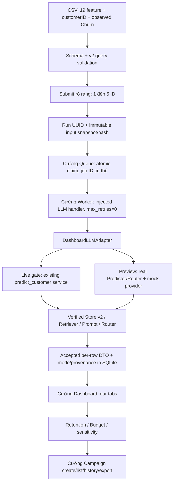

# Dashboard Cường làm app chính — LLM/RAG v2 là dịch vụ dự đoán

Nguồn UI/dịch vụ Cường: `origin/demo-test-04@911a60a028cb89507d35fbe584059f30f7ee2da4`.
Bản UI này đã vào `main` qua `1671f52`; các file runtime bị bỏ sót đã được bổ sung ở `632dd8f`. Trạng thái rà soát cuối và các phần giữ lại nằm ở mục cập nhật cuối tài liệu.

## Dashboard trước đây dùng model gì?

`dashboard/app.py:761–769` của source tìm model.pkl đầu tiên trong artifacts/bundles hoặc
artifacts/bundle; `app.py:813–830` dùng BundlePredictor.load/predict_batch. Predictor ở
`adapters/predictor/bundle_predictor.py:18–33` gọi load_bundle và LoadedBundle.predict_proba.
`ml/training/bundle.py:115–147` chọn class 1 và gọi pipeline.predict_proba; loader tại
150–191 mở pickle/schema/metadata. Không kiểm tra loại Logistic Regression tại boundary.

Artifact được commit cùng source là `catboost-20261018T130222-seed42`:
metadata model_type=catboost; kiểm tra opcode pickle, không unpickle, thấy
sklearn.pipeline.Pipeline và catboost.core.CatBoostClassifier. Đây là bằng chứng CatBoost
cho artifact đó, không phải kết luận chỉ dựa vào nhãn UI. Resolver chọn file đầu tiên nên
môi trường có nhiều bundle có thể nạp bundle khác; không suy đoán model của process lạ.
Demo source dùng FakePredictor(seed=42), vẫn ưu tiên CSV thật nếu có và còn cached bundle
riêng cho SHAP. Không dùng các đường này trong Dashboard LLM mới.

## Luồng mới



Preview dùng MOCK provider, không có API request thật. `mock_prediction` đi qua Predictor,
Store/Retriever, Prompt, Router và response validation thật, chỉ generation là giả.
Live adapter có server-side opt-in và trỏ đúng Prediction Service `predict_customer` có
sẵn; test nối qua service đó với factory Router mock. UI preview không mở chế độ live.
Không đổi service/predictor API hoặc implementation Router/Providers.

## Hợp đồng dữ liệu

- CSV đúng 21 cột: 19 feature, customerID, Churn đã quan sát. customerID được đọc dạng
  chuỗi, giữ leading zero; không rỗng/trùng. CSV UTF-8, tối đa 2 MB/1.000 dòng để validate.
- Không fill mọi TotalCharges lỗi/thiếu thành 0. Dùng validation hiện có: chỉ cho missing
  TotalCharges khi tenure=0. Categorical vocab/schema và vector do v2 Store quyết định.
- Model chỉ nhận Mapping đúng 19 feature; ID và observed Churn không vào prompt/query.
  Không gán churn_prediction sang Churn. Prediction class do LLM trả giữ nguyên.
- Submit đơn một ID hoặc batch tối đa năm ID được chọn; không chấm toàn CSV trên load,
  upload, rerun, đổi tab, lọc khách hoặc đổi tham số kinh tế.
- Một row là một logical prediction; Router có thể gọi primary và fallback/hedge theo
  chính sách cũ. Max 5 logical predictions không có nghĩa max 5 provider requests.
- Timeout service cũ: Groq90s/Gemini30s, hedge60s/tổng120s mỗi logical call. Batch tuần tự
  tối đa khoảng 600s cộng overhead. Không thêm retry quanh Router; preview trả mock tức thì.

## Persistence và lỗi

SQLite state riêng, không dùng/sửa data/predictions.db hoặc model bundle cũ.
`dashboard_runs` lưu UUID, request key hash đầy đủ, snapshot/dataset hash, mode,
reference version/pin, predictor config ref; `dashboard_outcomes` lưu class/probability/
reason/provider/reference_count/calibrated=False và từng trạng thái attempt.

Request hash dùng request token + nội dung cohort + reference/pin + mode, không chỉ tên
file hay model prefix. Click lặp cùng request trả run cũ, không inference lại. Đổi nội dung
CSV dù cùng tên tạo run khác. Nút **Tạo lượt mới** cấp token mới nhưng chưa gọi LLM;
người dùng vẫn phải submit rõ ràng. Run ID collision khác request bị lỗi, không bỏ qua
để dùng probability cũ. Attempt được ghi trước provider call; kết quả thành công ghi
trước row kế tiếp và không ghi đè accepted outcome.

Sau lỗi đầu tiên: fail-fast, giữ các row thành công, không chấm các row còn lại. Run có
trạng thái PARTIAL/FAILED; Dashboard/Retention chỉ dùng successful subset và hiển thị
số row thành công/tổng số trong snapshot. Raw SDK exceptions/prompt/API keys không lưu
vào DB hoặc đưa ra UI. Unknown attempts sau crash không tự replay.

Queue giữ chức năng job/status/idempotency, sửa atomic claim và fenced completion.
Process chỉ đúng job vừa submit, không nhặt job khác trong queue. Job LLM max_retries=0.
Job RUNNING bị ngắt chỉ đóng khi người dùng xác nhận worker đã dừng; thao tác này đánh
unknown/failed, không gọi lại API. Đây không phải bảo đảm exactly-once billing của provider.
Không dùng cơ chế lease tự retry một API call có thể đã phát sinh phí.

Legacy default handler/IdempotentPredictionStore còn trong worker.py cho compatibility,
nhưng Dashboard inject handlers rõ ràng và không khởi tạo store đó. Runtime isolation
chặn model imports/files và constructor legacy store để kiểm chứng ranh giới này.

## Business UI giữ lại

Bốn tab Cường: tổng quan kinh tế; observed churn/LLM reason; Customer360; Budget/Campaigns.
Giữ action catalog/conditions, greedy budget, margin sensitivity, bộ lọc/profile/charts,
Campaign create/list/history/export. Sửa all-A0/empty report, literal customer search,
escape ID khi dựng HTML, giới hạn chi phí không âm và chặn overflow kinh tế.

Global/Local TreeSHAP bị vô hiệu hóa riêng. Không làm feature importance giả cho LLM.
Thay bằng reason được hiển thị như text, có nhãn mock/provider/reference. Bỏ nhãn
CatBoost ROC-AUC cũ vì không mô tả LLM. EDA dùng observed Churn trong accepted cohort,
không được coi là performance validation hoặc quan hệ nhân quả của LLM.

Campaign dùng scoring_run_id thật, dataset hash của accepted subset, predictor config
ref (không phải actual provider model version), reference pin/version, execution mode,
calibrated=False và đầy đủ action params. Snapshot bất biến tại repository; cập nhật
status không được đổi cohort/budget/results. CSV preview read-only; status EXPORTED chỉ
khi người dùng bấm download, biểu thị export request chứ không chứng minh tải xong.
CSV giữ 6 cột tương thích; tên file xuất preview có tiền tố MOCK và báo cáo ghi rõ mode.
CSV có bảo vệ formula injection cho text/ID. NaN breakeven không xác định được serialize
thành JSON null, không đổi phép tính engine.

## Preview và kiểm thử

Preview launcher ngoài repository đặt light theme phù hợp CSS Cường, tắt telemetry,
xóa API keys, chặn socket connect ra ngoài và chỉ bind localhost. Server cũ giữ nguyên.
Có sẵn run gồm bốn khách tổng hợp, provider outputs giả; đây không phải kết quả thật.
Không cần Terminal để trải nghiệm preview đã được khởi chạy.

Nếu khởi chạy thủ công trong một môi trường phát triển đã chuẩn bị artifact đúng pin:

```bash
PYTHONPATH=src python3 -m churn_retention.dashboard.demo
```

Launcher demo một quản trị viên tạo SQLite riêng trong thư mục tạm 0700;
`--state-dir` chỉ nhận thư mục demo riêng có marker, không nhận database production.
Lệnh `streamlit run` trực tiếp không được phục vụ Dashboard. Xem
[group5_single_admin_security.md](group5_single_admin_security.md) để biết điều kiện vận hành. API keys không cần cho mock. Plotly>=7.1,<8 là dependency trực
 tiếp của Dashboard, đã kiểm thử với 7.1.0; task không cài/download package.

Test mới dùng synthetic CSV/artifact và fake providers: upload đúng bytes, ID alignment,
missing/duplicate/schema errors, run collision/idempotency, batch cap/partial/fail-fast,
atomic claims/recovery fencing, business UI all-A0, persistence/Campaign immutability và
chặn inference trên rerun. Minimal deployment process sạch không có training/ML code,
CSV thật, bundle/v1; cấm provider SDK/network/refit/classifier construction/unpickle.
Full regression giữ các golden fixtures và source preprocessing/RAG/prompt/router nguyên byte.

## Giới hạn

Live API không mở trên preview và chưa được kiểm chứng bằng API thật. Actual model version
không có trong DTO hiện tại; config ref không được trình bày là model version thực tế.
Chưa có production auth/tenant isolation, API billing guarantee hoặc worker fleet vận hành.
Probability chưa hiệu chuẩn và efficacy/acceptance là giả định; ROI chỉ là mô phỏng.
Artifact v2 hợp lệ vẫn là điều kiện mở luồng Dashboard hiện tại; không có read-only history
mode khi artifact không khả dụng. Không fallback v1/classifier. Bộ dependencies chung vẫn
chứa packages ML của toàn project, dù runtime Dashboard LLM không dùng classifier.


## Rà soát tích hợp main ngày 2026-11-02

Đây là cập nhật thay thế kết luận bàn giao “đã hợp nhất hoàn tất” trước đó.
Không suy số lượng tests từ số dòng code. Không tạo task hoặc chia việc mới.
Không tìm thấy AGENTS.md áp dụng trong repository hoặc các thư mục cha.

### Trạng thái đã xác minh trước khi sửa

- Main local `646f13e3c88d4a80d611c0b8614022212a861021`, sạch;
  origin/main `e26c373898afb7b7e08dab74e8c26c219518723c`, ahead 14.
  Fetch origin xác nhận remote chưa có commit mới.
- Worktree tích hợp `/private/tmp/churn-integration-worktree`, nhánh `integration-merge`
  tại `e45dee1`, sạch; một worktree demo cũ đã mất thư mục nhưng còn metadata prunable.
  Không prune/xóa metadata, worktree hay branch trong đợt sửa này.
- Hai stash: `372b56e` (backup trước tích hợp) và stash cũ trên `fix/week1-review`.
  Không apply/pop/drop toàn bộ stash. Nội dung và thứ tự stash được giữ nguyên.
- Collection ban đầu: **928 tests collected, 9 collection errors**. Vì thiếu llm_input,
  llm_prediction_service và exports, main ban đầu chưa đủ bằng chứng “chạy được”.
- Remote `integration` trỏ tới chính worktree local, không phải remote giao việc độc lập.
  Đã fetch cả origin và integration. Các refs integration/* phản chiếu nhánh local;
  bảng dưới gộp local/origin, không đếm các mirror đó thành task mới.

### Bảng task / branch / commit

Các nhánh cùng tên local/origin được nhóm lại. Ancestry và nội dung đều được kiểm tra;
cherry-pick/copy không được coi là chưa tích hợp chỉ vì commit gốc không là ancestor.

| Branch local/remote | Tip được rà soát | Kết quả và trạng thái trên main |
|---|---|---|
| `chore/lint-cleanup`, `origin/chore/lint-cleanup` | `d1dccdd` | Đã vào main theo ancestry (bao gồm lịch sử merge d910a78 nếu thuộc hạ tầng dữ liệu). |
| `chore/sample-bundle`, `origin/chore/sample-bundle` | `8dc8b6b` | 8dc8b6b → 33d2e1c; giữ artifact nguyên byte; nạp/predict 2 dòng thành công. Chỉ luồng ML truyền thống dùng bundle này. |
| `chore/training-image`, `origin/chore/training-image` | `9fcc0bb` | Đã vào main theo ancestry (bao gồm lịch sử merge d910a78 nếu thuộc hạ tầng dữ liệu). |
| `feat/contracts-scoring`, `origin/feat/contracts-scoring` | `d7945f0` | Đã vào main theo ancestry (bao gồm lịch sử merge d910a78 nếu thuộc hạ tầng dữ liệu). |
| `feat/ml-baseline-bundle`, `origin/feat/ml-baseline-bundle` | `b64d830` | Đã vào main theo ancestry (bao gồm lịch sử merge d910a78 nếu thuộc hạ tầng dữ liệu). |
| `feat/ml-batch-scoring` | `7341854` | Nội dung đã tích hợp qua 1671f52/646f13e/632dd8f. So AST của toàn bộ Python delta: chỉ khác page capture, CLI calibration và service error classification (đều là tích hợp bổ sung). |
| `feat/ml-calibration`, `origin/feat/ml-calibration` | `68aca4e` | Cherry-pick 0d5bf7f…68aca4e → 69a66ef…9e6692c; CLI giữ cả tune/calibrate/batch. Chỉ calibration Logistic; không áp dụng cho probability LLM. |
| `feat/ml-experiments`, `origin/feat/ml-experiments` | `1a3b674` | Đã vào main theo ancestry (bao gồm lịch sử merge d910a78 nếu thuộc hạ tầng dữ liệu). |
| `feat/ml-explain`, `origin/feat/ml-explain` | `19d0838` | Đã vào main theo ancestry (bao gồm lịch sử merge d910a78 nếu thuộc hạ tầng dữ liệu). |
| `feat/ml-real-data`, `origin/feat/ml-real-data` | `9b5c7cf` | Đã vào main theo ancestry (bao gồm lịch sử merge d910a78 nếu thuộc hạ tầng dữ liệu). |
| `feat/ml-train`, `origin/feat/ml-train` | `e92ecb6` | Đã vào main theo ancestry (bao gồm lịch sử merge d910a78 nếu thuộc hạ tầng dữ liệu). |
| `feat/ml-train-workflow` | `18c4a6a` | Đã vào main theo ancestry (bao gồm lịch sử merge d910a78 nếu thuộc hạ tầng dữ liệu). |
| `feat/scoring-screen`, `origin/feat/scoring-screen` | `509e8e3` | Đã vào main theo ancestry (bao gồm lịch sử merge d910a78 nếu thuộc hạ tầng dữ liệu). |
| `feat/scoring-slice`, `origin/feat/scoring-slice` | `ac3f315` | Đã vào main theo ancestry (bao gồm lịch sử merge d910a78 nếu thuộc hạ tầng dữ liệu). |
| `feat/scoring-streamlit`, `origin/feat/scoring-streamlit` | `4e3f416` | Đã vào main theo ancestry (bao gồm lịch sử merge d910a78 nếu thuộc hạ tầng dữ liệu). |
| `feature/data-infrastructure-ci`, `origin/feature/data-infrastructure-ci` | `e6fa0ce` | Đã vào main theo ancestry (bao gồm lịch sử merge d910a78 nếu thuộc hạ tầng dữ liệu). |
| `feature/dataset-ingestion`, `origin/feature/dataset-ingestion` | `18c4a6a` | Đã vào main theo ancestry (bao gồm lịch sử merge d910a78 nếu thuộc hạ tầng dữ liệu). |
| `feature/dataset-validation`, `origin/feature/dataset-validation` | `ff11c00` | Đã vào main theo ancestry (bao gồm lịch sử merge d910a78 nếu thuộc hạ tầng dữ liệu). |
| `feature/frontend-test`, `origin/feature/frontend-test` | `94243ba` | Tích hợp chọn lọc UI/nghiệp vụ từ demo-test-04@911a60a qua 1671f52; nguồn gốc/hash ở cuong_dashboard_source.json và retention_source.json. Giữ lại code fallback ML/TreeSHAP trên Dashboard, bootstrap/settings và Docker public cũ; không tuyên bố toàn nhánh tương đương main. |
| `feature/person3-retention`, `origin/feature/person3-retention` | `815ae71` | Tích hợp chọn lọc UI/nghiệp vụ từ demo-test-04@911a60a qua 1671f52; nguồn gốc/hash ở cuong_dashboard_source.json và retention_source.json. Giữ lại code fallback ML/TreeSHAP trên Dashboard, bootstrap/settings và Docker public cũ; không tuyên bố toàn nhánh tương đương main. |
| `feature/ui-ux-vibe`, `origin/feature/ui-ux-vibe` | `717c62f` | Tích hợp chọn lọc UI/nghiệp vụ từ demo-test-04@911a60a qua 1671f52; nguồn gốc/hash ở cuong_dashboard_source.json và retention_source.json. Giữ lại code fallback ML/TreeSHAP trên Dashboard, bootstrap/settings và Docker public cũ; không tuyên bố toàn nhánh tương đương main. |
| `fix/d1-2-validator-nonfinite`, `origin/fix/d1-2-validator-nonfinite` | `96e67a1` | Port validator/tests và hunk cleaner giữ số không hữu hạn trong d910a78; thêm chặn dữ liệu gốc trước cleaning. Test METADATA_FILE cũ chuyển sang kiểm chứng repository hiện hành. |
| `fix/evaluation-hardening`, `origin/fix/evaluation-hardening` | `1c00735` | Đã port đủ metrics.py, report.py, test_evaluation_report.py trong d910a78. Diff ba file với đầu nhánh rỗng sau format. |
| `fix/leakage-audit-update`, `origin/fix/leakage-audit-update` | `d85d79e` | Đã vào main theo ancestry (bao gồm lịch sử merge d910a78 nếu thuộc hạ tầng dữ liệu). |
| `fix/train-split-guard`, `origin/fix/train-split-guard` | `b47235b` | Cherry-pick 486719f…b47235b → 8acd7fa…262a2eb; cả guard và tests đã có. |
| `fix/week1-review`, `origin/fix/week1-review` | `4e06ebb` | Đã vào main theo ancestry (bao gồm lịch sử merge d910a78 nếu thuộc hạ tầng dữ liệu). |
| `integration-merge` | `e45dee1` | Dùng đối chiếu/khôi phục chọn lọc tại 632dd8f; không merge lại 30 commit trùng. Bỏ duplicate contracts/models.py và root jobs exports; giữ contracts/jobs/models.py chuẩn. |
| `test/r1-2-rank-benefit`, `origin/test/r1-2-rank-benefit` | `7712124` | Commit riêng 7712124 → ff85821; regression công thức/ranking được tích hợp. Các phần UI/model cũ trong ancestry không nhập lại. |
| `origin` | `e26c373` | Đã vào main theo ancestry (bao gồm lịch sử merge d910a78 nếu thuộc hạ tầng dữ liệu). |
| `origin/demo-test-04` | `911a60a` | Tích hợp chọn lọc UI/nghiệp vụ từ demo-test-04@911a60a qua 1671f52; nguồn gốc/hash ở cuong_dashboard_source.json và retention_source.json. Giữ lại code fallback ML/TreeSHAP trên Dashboard, bootstrap/settings và Docker public cũ; không tuyên bố toàn nhánh tương đương main. |
| `origin/error-analysis` | `bf6abf4` | Đã vào main theo ancestry (bao gồm lịch sử merge d910a78 nếu thuộc hạ tầng dữ liệu). |
| `origin/manage-dataset-storage` | `875b956` | Đã vào main theo ancestry (bao gồm lịch sử merge d910a78 nếu thuộc hạ tầng dữ liệu). |
| `origin/pipeline-leakage-review` | `d2069ad` | Đã vào main theo ancestry (bao gồm lịch sử merge d910a78 nếu thuộc hạ tầng dữ liệu). |

`feature/data-infrastructure-ci`, `fix/leakage-audit-update`, `pipeline-leakage-review`,
`error-analysis`, `manage-dataset-storage` đã có ancestry qua merge `d910a78`.
Bao gồm API upload/list/detail/quality, Parquet + metadata DB, migrations 001/002,
metrics/segments/error-analysis, leakage audit và CI. Dataset service dùng local
Parquet; S3 adapter cũ chưa được smoke với dịch vụ S3/MinIO thật.

Các phần UI giữ lại có khác biệt cụ thể: Dashboard cũ tự nạp bundle đầu tiên và
TreeSHAP; bản chính dùng kết quả LLM đã lưu và reason, tách observed Churn. Docker cũ
bind 0.0.0.0, bỏ qua launcher local an toàn và healthcheck dùng curl chưa được cài.
Không đưa Docker đó vào main khi chưa có thiết kế triển khai phù hợp. Các đặc tả kinh tế
cũ được đối chiếu với docs/group4_business_services.md; không lấy lại số liệu “Approved”
hoặc fallback predictor như bằng chứng deploy/live đã đạt.

### Đối chiếu stash theo file/hunk

| File trong stash backup 372b56e | Quyết định |
|---|---|
| .gitignore | Lấy ignore `.dashboard-preview/`; giữ DB local, bỏ tracking ở 632dd8f. |
| README.md | Lấy cách chạy standalone/Dashboard; cập nhật lại hướng dẫn trên main. |
| apps/streamlit/pages/2_Predict.py | Lấy capture_submission/clear_record, bổ sung page bị thiếu. |
| docs/llm_predictor.md | Giữ hunk ví dụ cũ trong stash: snippet dùng reference_version `ref-…` cũ; runtime chính hiện dùng artifact v2 `rag-v2-…`. Không đưa ví dụ đó vào tài liệu v2 như kết quả đã kiểm chứng. |
| pyproject.toml | Tích hợp plotly; bổ sung Groq/GenAI/httpx và toàn bộ deps data/CI. Runtime deps nằm trong base package, không chỉ dev extra. |
| adapters/task_queue/__init__.py | Lấy exports TaskQueue/SqliteTaskQueue. |
| contracts/jobs/__init__.py | Lấy exports TaskJob/JobType/JobStatus từ module canonical. |
| entrypoints/streamlit/llm_prediction_service.py | Lấy credential boundary và typed failure codes; giữ factory/timeout hiện tại. |
| entrypoints/worker/__init__.py | Lấy exports worker. |
| modules/campaigns/__init__.py | Lấy public exports campaigns. |

Stash cũ trên fix/week1-review chỉ có train_model.py/test_train_workflow.py, bỏ bớt
validation/tests. Không khôi phục vì main mới giữ validation chặt hơn và có đầy đủ
guard train/validation. Không xóa stash đó.

### Sửa chữa cần thiết

- `632dd8f`: khôi phục page/form/service/exports bị bỏ sót; đồng bộ SQLite adapter,
  CLI và tests với lease recovery, public error filtering, use-case status query
  (nguồn `3d8b663`, `e92801d`, `4fdc912`).
- `d910a78`: validate dữ liệu gốc trước cleaner để không biến nhãn/số/ID sai thành 0;
  giữ customerID dạng chuỗi; giữ missing TotalCharges hợp lệ cho tenure=0;
  kiểm tra upload sai không ghi Parquet hay metadata. 7 regression cases mới.
- `d6cd65b`: áp dụng Ruff hiện có cho các file tích hợp, không giảm luật CI.
  So AST xác nhận string/f-string giữ nguyên giá trị khi xuống dòng. Các thay đổi
  ngoài format: bỏ sys.path bootstrap dư, giữ runtime guard trước UI, đơn giản hóa
  numeric conversion phù hợp pandas typing và zip strict=False giữ hành vi cũ.
- `9b768d8`: Alembic env thiếu dispatch nên upgrade trước đó là no-op. Đã gọi online/
  offline migration và kiểm tra bảng/cột thật sau upgrade, bảng biến mất sau downgrade.
- Theo xác nhận trực tiếp của người dùng trong chat: **giữ model/provider hiện tại**,
  bao gồm Qwen nếu đang dùng, và **giữ timeout hiện tại**. Không thêm GROQ_MODEL bắt buộc,
  không chặn Qwen, không đổi Router. Defaults: Groq qwen/qwen3.8-27b và Gemini
  gemini-3.5-flash-lite; Groq90s/Gemini30s, hedge60s, tổng120s, cooperative cancellation.

### Kiểm chứng

- Full regression strict private-assets, chặn kết nối ngoài: **1437 passed, 1 skipped,
  17 warnings**, 470.80s. Skip duy nhất là test cần DATABASE_URL PostgreSQL;
  sau đó đã chạy riêng test này cùng migration trên PostgreSQL 17 UTF-8: **2 passed**.
- Nhóm data/evaluation/lifecycle/boundaries: **77 passed**.
- Calibration + split guards + batch scoring: **88 passed**; sau chỉnh nội dung báo cáo
  calibration cho phù hợp main, chạy riêng calibration: **11 passed**.
- Ruff check và format theo CI: pass. Mypy: **124 source files, no issues**.
- Build wheel + source distribution thành công trong virtualenv build tạm riêng.
- Golden v1/v2 chạy strict-assets; fixture public không sửa, assets private không commit.
- API health + đăng ký routes dataset: pass. CLI có đủ tune/calibrate/score-batch/job-status.
- Sample CatBoost bundle load/predict 2 dòng: pass; không thay predictor Dashboard.
- Chrome smoke Dashboard chính: mock prediction → Queue/Worker SUCCESS → đủ 4 tab →
  Customer360/Retention/Budget → lưu campaign → xuất CSV → **EXPORTED**.
  Chỉ dữ liệu tổng hợp, state DB tạm riêng; không gọi API trả phí.
- Quét file tracked không có hit theo các pattern provider/cloud/private key đã kiểm tra;
  không có DB runtime được tracking. Đây là kiểm tra pattern, không phải chứng minh
  mọi chuỗi bất kỳ đều không nhạy cảm.

### Giới hạn còn lại

LLM live/API quota/model availability chưa kiểm chứng; probability LLM chưa được
calibration/validation chất lượng. Campaign/ROI là mô phỏng; không thực thi ưu đãi thật.
Chưa có multi-user authentication/tenant isolation, worker fleet/HA hay cấu hình production.
Dashboard hiện dành cho một admin trên loopback qua launcher. Không suy diễn pass mock
thành pass live/deploy. Không có task mới được phân công.

Trạng thái push và HEAD cuối sẽ được chốt sau lần fetch/kiểm tra cuối trong chat bàn giao.
