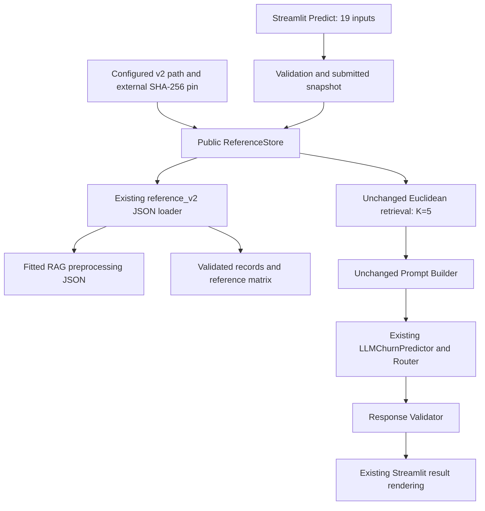

# LLM/RAG runtime migration — step 7.6

The Predict page now uses the approved reference artifact v2 by default. It restores
fitted feature preprocessing from JSON, transforms the same 19 inputs, retrieves
five examples and invokes the existing prompt/predictor/router/response-validation
flow. It never fits preprocessing, loads a classifier or falls back to artifact v1.
This document supersedes the runtime-boundary statements in the historical step
7.5 report; the artifact format and builder from that step are unchanged.

## Runtime and compatibility

`reference_store.py` exports the existing `VerificationReferenceV2` implementation
as `ReferenceStore`, without another Store class or an import of a v1 loader.
`load`, `prepare_query`, `clean_features`, `records`, `matrix`, `feature_schema`
and `reference_version` remain available. Optional reference-version and dataset
hash filters are supported. Old model-bundle filters remain exclusively in v1.
V2 errors inherit the neutral `ReferenceArtifactError` for existing callers.

The pre-migration v1 Store was preserved byte-for-byte in
`legacy_reference_store.py`. The v1 builder, golden capture script and v1-specific
tests explicitly import it. The immutable v1 fixtures are not regenerated or
edited. The retriever accepts a neutral structural `ReferenceSource` protocol;
all retrieval method bodies remain AST-identical. The predictor, prediction
service, Prompt Builder, Router and Providers implementations are unchanged.

## Artifact configuration and cache

Default artifact: `artifacts/references/telco-train-v2.zip`.

Default approved archive SHA-256:
`c85e61be7edfd0e91b248e0e353088677a345a378e64840b1613b51194b40bf8`.

Reference version: `rag-v2-dcbf9bbad91d309d0b84`.

Administrators can configure `CHURN_LLM_REFERENCE_ARTIFACT` and
`CHURN_LLM_REFERENCE_SHA256`. A replacement artifact needs its own externally
approved hash. Do not derive that approval from an unknown file or its manifest.
Blank paths, malformed pins and mismatches are rejected. The Streamlit runtime
always passes the external pin, never `trusted=True`.

The v2 loader reads one bounded byte snapshot and authenticates those exact bytes
before ZIP parsing. It verifies manifest, payload checksums, exact library
versions, feature schema, fitted preprocessing, train-only provenance, matrix
shape/dtype/value hash and record alignment. No pickle or classifier is required.
The records are retransformed for alignment validation, without fitting.

Session caching uses resolved path, device/inode, size, modification/change times
and the configured pin. The identity is checked again after loading. A changed
file/path/pin invalidates cached LLM resources, snapshots and results. This cheap
stat fingerprint is cache invalidation, not artifact authentication. Re-loading
always verifies the pin. Failure renders a sanitized error and stops before the
Router; it never tries an old bundle. `active_scoring_context` is untouched.

The existing form groups, 19 features, validation, loading spinner, submitted
snapshot and result rendering remain. Reference version displays the v2 value.
No internal neighbor IDs enter prompts or public reports.

## Scope of independence

The Predict page and its LLM/RAG call chain no longer import the legacy Store,
`_artifact.py`, training pipeline or bundle predictor. They require neither
`model.pkl`, a model bundle, `feature_schema.json` from that bundle nor v1 ZIP.
No LogisticRegression object is instantiated or called.

The unrelated shared Streamlit root `apps/streamlit/scoring_page.py` still imports
`BundlePredictor`, and the project keeps its combined dependency/package layout.
Starting that shared root can still import legacy training code. This task does
not make the entire Streamlit application/distribution independent: separating
its entrypoint is explicitly out of scope. Scoring, Explain, LR, training, batch
and SHAP implementations and `pyproject.toml` are unchanged.

Scikit-learn remains necessary for feature transformers. Its `sklearn.compose`
import currently reaches the `sklearn.linear_model` namespace through an unrelated
LinearRegression import. Isolated tests make the actual logistic implementation
unavailable and replace its namespace exports with non-instantiable sentinels.
This demonstrates absence of a classifier dependency without claiming that no
library namespace mentions logistic regression.

## Regression coverage

The new runtime tests cover:

- Public Store reuse, explicit trust, version/source filters and no v1 fallback.
- External pin authentication of the exact byte snapshot, even if the source path
  changes after hashing.
- Full matrix and all eight fixed vectors, ordered top-five IDs, distances,
  ordered examples and complete prompt hashes against the unchanged v1 baseline.
- Deterministic tie-breaking and self-exclusion with controlled synthetic IDs.
- Default v2 form, cache reuse/invalidation, snapshot, result/reference version
  rendering and preservation of `active_scoring_context`.
- Missing artifact, payload checksum tampering, wrong schema, wrong matrix shape,
  unapproved source/hash, malformed pin and explicit v1 rejection before Router.
- Fresh-process full UI integration for both valid and invalid LLM responses:
  validation, v2 load, retrieval, prompt, real Router with mock providers, response
  validation and rendering. Import/open barriers prohibit training, v1, old
  bundles, classifier implementation and classifier deserialization. Fit methods
  and network sockets are disabled; no provider SDK is loaded or API called.

The LLM unit fixtures now build small independent v2 artifacts from synthetic
train records; preprocessing receives only features. V1 tests keep the explicit
legacy loader as an oracle.
Original datasets, splits, artifacts and golden expected values are untouched.

## Files in this migration

Seventeen files that already existed in the working tree changed in this step:

| Files | Change |
| --- | --- |
| `src/churn_retention/adapters/retrieval/reference_store.py` | V2-only public facade |
| `src/churn_retention/adapters/retrieval/reference_v2.py` | Shared runtime interface, compatibility filters and single authenticated byte snapshot |
| `src/churn_retention/adapters/retrieval/_reference_v2_format.py` | Error inherits neutral artifact error |
| `src/churn_retention/adapters/retrieval/nearest_neighbors.py` | Neutral structural type annotation; algorithm bodies unchanged |
| `src/churn_retention/entrypoints/streamlit/llm_input.py` | Approved v2 defaults and configurable external pin |
| `apps/streamlit/pages/2_Predict.py` | V2 configuration and pin-aware cache invalidation |
| `src/churn_retention/workflows/build_reference.py` | Import-only routing to preserved v1 Store |
| `scripts/capture_llm_rag_golden.py` | Import-only routing to preserved v1 Store |
| `tests/test_reference_retrieval.py`, `tests/test_reference_retrieval_integration.py`, `tests/test_llm_rag_golden.py` | Explicit legacy oracle imports; expected values unchanged |
| `tests/test_llm_input.py`, `tests/test_llm_input_page.py`, `tests/test_llm_prediction_service.py`, `tests/test_llm_streamlit_e2e.py`, `tests/test_llm_predictor.py` | Independent v2 unit fixtures and runtime expectations |
| `tests/test_llm_prompt.py` | Neutral DTO imports |

Five files are new:

- `src/churn_retention/adapters/retrieval/legacy_reference_store.py`: exact copy of
  the pre-migration v1 Store, including all earlier uncommitted work.
- `src/churn_retention/contracts/reference_source.py`: neutral retrieval protocol.
- `tests/llm_v2_fixtures.py`: small independent synthetic v2 fixtures.
- `tests/test_llm_runtime_v2.py`: 26 runtime/golden/security/integration cases.
- `docs/llm_runtime_v2.md`: this report.

## Equivalence and operational risks

The immutable baseline requires a 4,930 x 45 float64 reference matrix, eight
1 x 45 query vectors, five neighbors per query and eight complete prompt hashes.
Matrix/vector bytes and neighbor/example order must remain exact. Euclidean
distances use the existing absolute/relative tolerance of 1e-12; library/BLAS
rounding can differ around 2e-15 without changing neighbors or prompts. Tie order
and self-exclusion retain the original retrieval algorithm.

Artifact v2 and private baseline are intentionally Git-ignored and contain
internal records. Deployments must provision the approved v2 file separately;
missing files fail closed. A future rebuild changes the pin/version and requires
explicit approval plus golden verification. Exact sklearn/NumPy/pandas versions
are part of the format; upgrading them can require a separately reviewed artifact
and codec update. These restrictions are preserved rather than bypassed here.

Only runtime migration is implemented. No preprocessing v3, artifact rebuild,
entrypoint split, deployment, commit or push is performed.

## Verification on 2026-11-01

| Check | Result |
| --- | --- |
| New runtime v2 tests | 26 passed |
| Required runtime, v2 Store, preprocessing, retrieval, prompt, predictor, Streamlit and golden group | 486 passed |
| Full regression suite | 952 passed, 15 warnings, no skipped tests (197.64 seconds) |
| Full 4,930 x 45 float64 matrix and eight vectors | Exact hashes |
| Eight top-five neighbor ID/order comparisons | Exact hashes; IDs remain private |
| Euclidean distances | Existing atol/rtol 1e-12 satisfied |
| Eight complete prompts | Exact hashes, five examples each |
| Ties and self-exclusion | Passed |
| Fresh-process UI success/error integration | Both passed without old bundles/v1/classifier/training, fitting or network |
| Ruff check and format check, 21 Python files in this migration | Passed |
| Mypy, all 21 Python files in this migration | Passed |

Global `ruff check .` still reports the pre-existing unsorted import in
`notebooks/explore_and_split.py`. Global `ruff format --check .` still reports
that notebook and code fences in `docs/llm_predictor.md` and
`docs/reference_retrieval.md`. These three files retain their pre-task hashes;
unrelated pending work was not reformatted. The full test warnings come from
existing bundle-name/dirty-tree checks and third-party deprecations.

Tests used a socket-blocking guard and fake provider credentials/responses; no
real API was called. The independent subprocesses also install their own network
and legacy import/file barriers. Golden asset checks were required, not skipped.

Git branch remains `feat/ml-batch-scoring`; HEAD remains
`84109d9178acf5d11d3d49770eb22568c9f958d4`. Of 177 pre-existing files snapshotted
before this task, only the 17 files listed above changed. Protected data, split
manifest, both artifacts, model bundles, golden fixtures, LR/training/batch/SHAP,
Router/Providers, predictor/service, shared scoring entrypoint, Explain and
`pyproject.toml` retain their hashes. The v1 Store copy is byte-for-byte identical
to the pre-task Store. Existing dirty paths remain present. No Git write or
network operation was performed.
