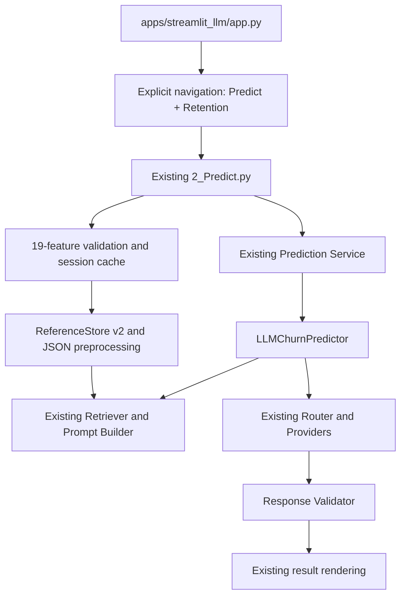

# Streamlit LLM + RAG độc lập — bước 7.7

Chạy từ repository root:

```bash
PYTHONPATH=src python3 -m streamlit run apps/streamlit_llm/app.py
```

Có thể chạy từ thư mục khác bằng đường dẫn tuyệt đối cho `PYTHONPATH` và file
entrypoint. Đường dẫn trang Predict và artifact mặc định được giải từ vị trí file,
không phụ thuộc working directory của shell.

Entrypoint đăng ký đúng hai trang qua `st.Page` / `st.navigation`:
Predict (`apps/streamlit/pages/2_Predict.py`) và mô phỏng
(`apps/streamlit_llm/retention_page.py`). Không import hoặc khởi chạy
`apps/streamlit/scoring_page.py`, Explain, training, batch scoring hoặc SHAP.
Không có bản sao thứ hai của form hay logic dự đoán. Predict bổ sung capture PredictionRecord sau submit thành công; Prediction
Service, RAG, preprocessing, Router và Providers giữ nguyên implementation.

Navigation sidebar dùng allowlist Predict và Retention/Budget;
ranh giới truy cập là danh sách đăng ký tường minh. `st.navigation` vô hiệu hóa
auto-discovery của `pages/` trên toàn bộ session trong cùng process, kể cả khi
thư mục đó chứa file khác. Trang không đăng ký không thể được mở bằng navigation
hoặc deep link. Xem [hành vi navigation chính thức của Streamlit](https://docs.streamlit.io/develop/concepts/multipage-apps/pages-directory).

App cũ vẫn chạy bằng entrypoint cũ. Nếu cần cả hai ứng dụng, chạy hai process
Streamlit riêng và chọn port khác nhau. Không chuyển app mới thành một page của
entrypoint legacy; điều đó sẽ đưa import legacy trở lại process dùng chung.

## Cấu hình và dữ liệu

- Mặc định: `artifacts/references/telco-train-v2.zip`, reference version
  `rag-v2-dcbf9bbad91d309d0b84`.
- Hash pin ngoài artifact:
  `c85e61be7edfd0e91b248e0e353088677a345a378e64840b1613b51194b40bf8`.
- Có thể cấu hình `CHURN_LLM_REFERENCE_ARTIFACT` và
  `CHURN_LLM_REFERENCE_SHA256` trong môi trường server. Artifact thay thế phải có
  hash được phê duyệt độc lập. Không lấy hash của file không rõ nguồn để tự cấp
  quyền tin cậy cho chính file đó.
- Cấu hình cả `GROQ_API_KEY` và `GEMINI_API_KEY` trong môi trường server khi muốn
  dự đoán thật. Service hiện có yêu cầu cả hai key; không nhập key vào form hoặc
  lưu trong Git. App không tự đọc file `.env`.
- Task này chỉ kiểm thử bằng fake providers; không gửi prompt hoặc gọi API thật.

Loader v2 xác thực byte snapshot theo pin, kiểm tra manifest/payload/schema,
library versions, fitted state, provenance và matrix alignment. Chỉ restore
preprocessing JSON, không fit hoặc unpickle classifier. Thiếu/hỏng artifact,
pin sai hoặc v1 đều báo lỗi an toàn; không fallback về bundle/v1.

Cache, session state và validation được tái sử dụng nguyên từ Predict: đúng 19
feature, snapshot khi submit, TotalCharges thiếu chỉ hợp lệ khi tenure bằng 0,
không inference trên rerun. Cache identity gồm path/stat fingerprint và pin;
thay đổi sẽ loại bỏ resources/snapshot/result cũ. Lỗi được sanitize. Kết quả giữ
provider, K=5, reference version và cảnh báo probability chưa hiệu chuẩn.
`active_scoring_context` không bị thay đổi.

## Import graph và phạm vi độc lập



Khi đóng gói app, cần giữ entrypoint mới, file Predict được dùng chung, package
runtime LLM/RAG và artifact v2 được cấp phát riêng. Không cần dataset, split CSV
bên ngoài artifact, artifact v1, model bundle hoặc code training/LR/SHAP/batch.
Các module LLM nằm dưới `modules/scoring` là use case LLM, không phải batch scoring.

Độc lập ở đây là import/runtime. `pyproject.toml` vẫn khai báo dependency chung
của repository; bước này không tách wheel hoặc bộ dependency cài đặt riêng.
Scikit-learn vẫn cần cho feature transformers. `sklearn.compose` có import nội bộ
namespace `linear_model` cho target regressor; test làm implementation logistic
thực sự không khả dụng bằng poison exports không thể khởi tạo, như các bước trước.
Không có dependency vào classifier object/inference hoặc code LR của dự án.

## Kiểm thử

```bash
PYTHONPATH=src OPENBLAS_NUM_THREADS=1 OMP_NUM_THREADS=1 python3 -m pytest tests/test_llm_standalone_app.py -q
```

Test dựng một deployment tạm chỉ chứa runtime cần thiết, app mới, Predict dùng
chung và artifact v2 tổng hợp nhỏ. Code ML/training, SHAP, batch, scoring page,
bundle và artifact v1 thật không tồn tại trong deployment đó. Query là dữ liệu
tổng hợp, không đọc nhãn validation. Có hai page legacy giả cạnh entrypoint để
kiểm tra chúng không được đăng ký hoặc thực thi.

Mỗi trường hợp chạy trong Python process sạch với `-I`, import/file barriers,
classifier exports không thể khởi tạo, cấm refit/unpickle/network và Router thật
với fake providers. Kiểm tra allowlist hai trang, 19 widget, invalid/valid
submit, snapshot, rerun/draft, result, cache invalidation khi đổi pin/thay file,
missing keys, invalid LLM response, missing/untrusted artifact và v1 rejection.
Một smoke test bổ sung chạy entrypoint mới với artifact v2 thật mặc định và query
tổng hợp; test này skip nếu asset cục bộ thiếu, hoặc fail khi bật
`CHURN_GOLDEN_REQUIRE_ASSETS=1`.

Process riêng cũng tránh làm thay đổi navigation global của các test app legacy
đang dùng cơ chế `pages/`. Các golden fixtures không được sửa. Test navigation được mở rộng có chủ ý
cho đúng hai trang, thêm kiểm tra chuyển trang/rerun không gọi lại LLM.

Rủi ro còn lại: artifact cần cấp phát riêng và đúng phiên bản sklearn/NumPy/pandas
đã ghi nhận; dependency installation vẫn dùng cấu hình chung. Test dùng AppTest
và mock LLM, chưa xác minh API thật hoặc triển khai production. P2 về một số test
v2 cũ phụ thuộc private assets vẫn giữ nguyên; bộ standalone mới có sáu trường hợp
chạy được hoàn toàn bằng synthetic assets.

## Kết quả baseline 7.7 trước MVP (lịch sử, không phải kết quả MVP)

| Kiểm tra | Kết quả |
| --- | --- |
| 7 trường hợp standalone mới | Đạt trong nhóm kiểm thử liên quan |
| Standalone, runtime v2, retrieval, prompt, predictor, Streamlit và golden | 493 passed |
| Full regression | 959 passed, 15 warnings, không skip |
| Lệnh CLI từ ngoài repository, localhost health check | `ok`; server tạm đã dừng |
| Ruff check/format và Mypy cho 3 file Python mới | Đạt |

Smoke CLI không có LLM credentials, tắt telemetry và chặn network ra ngoài;
chỉ dùng localhost cho health check. AppTest đi qua validation/RAG/prompt/Router/
response validation và result với fake providers. Các bộ test khác cũng chạy
với socket guard; không gọi API LLM thật.

Ruff toàn repository vẫn có lỗi import cũ ở `notebooks/explore_and_split.py` và
formatting cũ tại notebook cùng hai tài liệu `docs/llm_predictor.md`,
`docs/reference_retrieval.md`. Những file này giữ nguyên hash trước tác vụ;
không tự động format hoặc sửa file P1.

Branch/HEAD giữ nguyên `feat/ml-batch-scoring` /
`7341854d2aedf94103916a3a59b696482c47eb30`. Trong 182 file đã có trước tác vụ,
chỉ README thay đổi để thêm lệnh chạy. Bốn file mới là entrypoint, hướng dẫn này
và hai file kiểm thử. File P1 vẫn modified đúng nội dung cũ; index trống.
Không commit/push, đổi nhánh hoặc deploy.

## MVP Retention/Budget

Mở `/retention` để dùng dữ liệu giả mà không cần API key hoặc artifact.
Xem [hướng dẫn MVP](llm_retention_integration.md) về nguồn code,
PredictionRecord, trạng thái hoạt động và kiểm thử.
