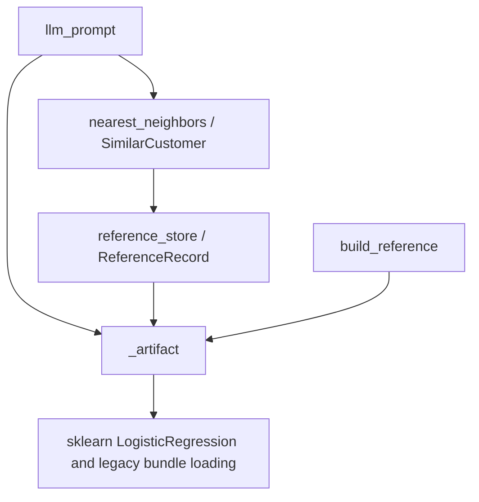
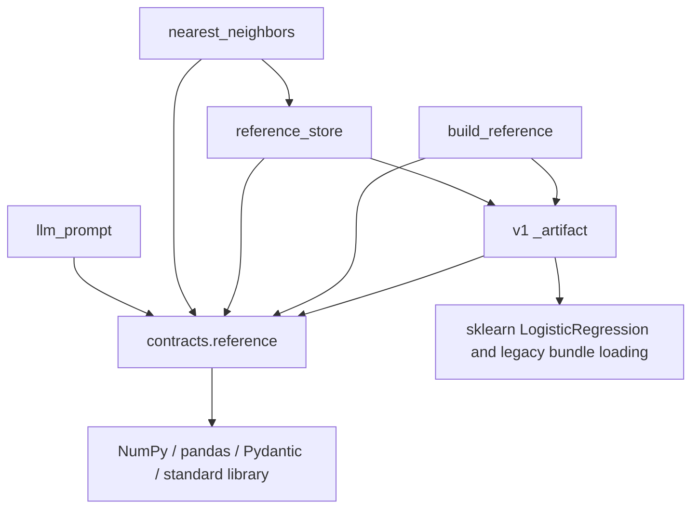

# Neutral reference contracts — step 7.3

This change separates neutral RAG types and validation from the v1 bundle loader.
It preserves the existing artifact, preprocessing, retrieval, and prompt behavior.
It does not make ReferenceStore or the complete LLM runtime independent of LR.

## Classification before the change

The complete original `_artifact.py` was classified before editing:

| Category | Original symbols | Decision and consumers |
| --- | --- | --- |
| Data contracts | `Scalar`, `ChurnLabel`, `Digest`, `_StrictModel`, `StoredRecord` | Move to neutral contracts; used by manifest, Store, builder, shared records |
| Feature schema | `FeatureColumn`, `NUMERIC_NAMES`, `QUERY_METADATA`, `validate_schema` | Move; used by Prompt Builder, Store, builder, legacy preprocessing checks |
| Input validation/canonical features | `validate_id`, `_number`, `clean_features` | Move unchanged; callers supply schema and category vocabulary |
| Shared validation error | `ReferenceArtifactError` | Move; the old adapter exports the same class for compatibility |
| Canonical serialization/hash | `json_bytes`, `sha256` | Move unchanged; used by builder, Store, bundle digest and checksums |
| Reference artifact validation | `ReferenceManifest`, `read_splits`, `validate_membership` | Keep in v1 adapter: manifest contains bundle fields and split-policy checks belong to artifact loading/building |
| Runtime compatibility | `runtime_versions` | Keep: v1 compares the saved sklearn/NumPy versions |
| Legacy bundle loading | `BUNDLE_FILES`, `bundle_digest`, `load_preprocessor` | Keep: inventory, metadata, checksum and trusted pickle loading are v1 responsibilities |
| LR-specific checks | Logistic model type, classifier `isinstance`, pipeline shape, label/config checks inside `load_preprocessor` | Keep unchanged for steps 7.4–7.6 |
| Preprocessing extraction | Fitted ColumnTransformer, step/type checks, vocabulary extraction inside `load_preprocessor` | Keep unchanged; no new preprocessing factory |
| Fitted transform/artifact matrix validation | `transform` | Keep unchanged in the v1 adapter; no algorithm or float64 conversion changes |

`bundle_digest` uses generic hash helpers but still describes a legacy bundle, so
it was not moved merely because it is short. The split validators are neutral
with respect to classifier mathematics but are only used by artifact load/build
paths; moving them is unnecessary for the requested import boundary.

The import graph also exposed an indirect dependency: `SimilarCustomer` lived in
`nearest_neighbors`, which imported ReferenceStore and therefore `_artifact`.
Consequently the shared dataclasses `ReferenceRecord`, `PreparedQuery`, and
`SimilarCustomer` were moved to contracts too. Their field order, frozen status,
ID/vector repr policy, inheritance, and prompt projection remain unchanged.

## Import graph before

## Import graph after

The contracts module performs no filesystem I/O, reads no model bundle, accesses
no fitted transformer, and imports no adapter, training module, or sklearn.
Validation retains NumPy scalar/dtype handling and pandas missing-value semantics;
these utilities are not Logistic Regression dependencies.

## Compatibility and protected behavior

- Existing public type/helper import paths in `_artifact` remain compatibility
  exports referring to the contracts objects.
- `reference_store.ReferenceRecord` and `.PreparedQuery`, and
  `nearest_neighbors.SimilarCustomer`, remain aliases for the shared dataclasses.
  There are no duplicate class definitions that would break `isinstance` checks.
- Prompt Builder directly imports both its schema and SimilarCustomer from the
  neutral contracts, avoiding the Store/adapter path entirely.
- Store and builder import neutral types/cleaning/hash helpers directly while
  keeping all v1 validation and loading calls.
- No method/function implementation changed: AST comparisons against pre-edit
  copies confirm both retained and moved definitions are identical.
- Artifact format, ordering, vocabulary, fitted state, distances, tie-breaking,
  output schema, prompt instructions, and serialization are unchanged.
- No existing tests, capture script, public/private golden fixtures, datasets,
  bundles, split manifest, or reference artifact were edited.

The v1 artifact stores JSON records/schema and a sklearn pipeline pickle. Moving
the neutral record classes therefore requires no artifact migration. Their Python
module location is now contracts; existing import paths resolve to the same
objects. No new artifact has been built or preprocessing fitted by this change.

## Verification

`tests/test_reference_contracts.py` adds isolated subprocess imports from an empty
working directory, with import barriers against all sklearn, ML, adapters and
workflow modules, a model-bundle read audit hook, and a network guard. These tests
cover both the contracts module and Prompt Builder, including class identity.
They do not infer independence merely from an already-populated `sys.modules`.

Other new tests use synthetic values and the public golden schema/vocabulary to
exercise valid and invalid inputs, missing values, schema errors, private-field
projection, deterministic serialization/hash behavior, and compatibility exports.
They neither load a model bundle nor fit preprocessing for validation tests.

The original 48 golden tests are run in strict local-asset mode. Existing
reference/retrieval, prompt, predictor, Streamlit and full regression suites are
also required. Golden fixtures must never be refreshed to conceal a regression.

Verification on 2026-10-31:

- 32 new contracts tests and 48 unchanged golden tests: 80 passed.
- Existing reference/retrieval, prompt, predictor and Streamlit LLM tests:
  275 passed.
- Full regression suite: 789 passed, 15 warnings, no skipped tests.
- Ruff check and format: all seven new/changed Python files passed.
- Mypy with `MYPYPATH=src` and `--explicit-package-bases`: all seven files passed.
- Network connections were blocked during verification; no real API was called.
- SHA-256 comparisons cover all 162 pre-existing source/data/artifact files.
  Only the five planned implementation files changed; all pre-existing dirty
  files, golden files, protected code and assets retain their original bytes.
- Branch and HEAD remain `feat/ml-batch-scoring` and
  `84109d9178acf5d11d3d49770eb22568c9f958d4`; no commit or Git integration action.

## Remaining dependency and next step

ReferenceStore still loads the v1 ZIP containing the complete model bundle. The
loader still checks logistic metadata, unpickles `model.pkl`, checks the LR class,
and extracts its fitted preprocessor. The builder still requires the source
bundle. Predictor, Streamlit runtime, and legacy test fixtures still reach these
paths. Existing packaging dependencies are unchanged.

This provides the neutral boundary needed for step 7.4. That later step must
separately address preprocessing ownership and build/runtime bundle dependencies,
using the unchanged golden vectors, matrix, neighbor order and prompt hashes as
oracles. No part of those later steps is implemented here.
